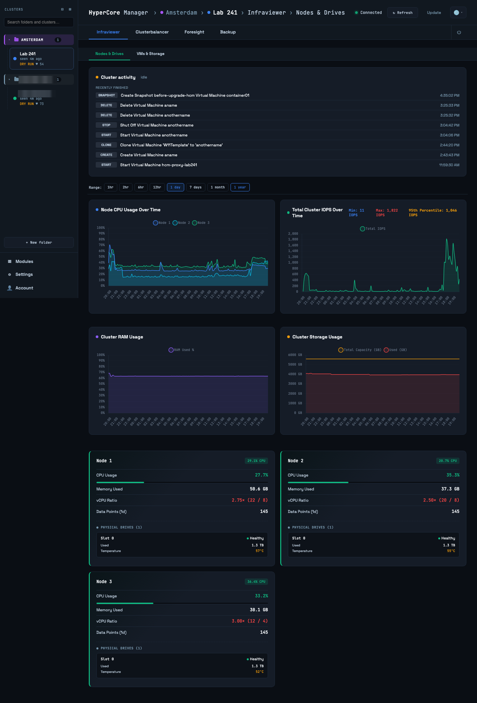
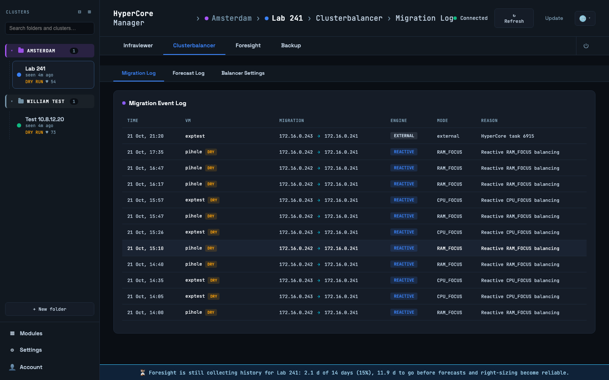
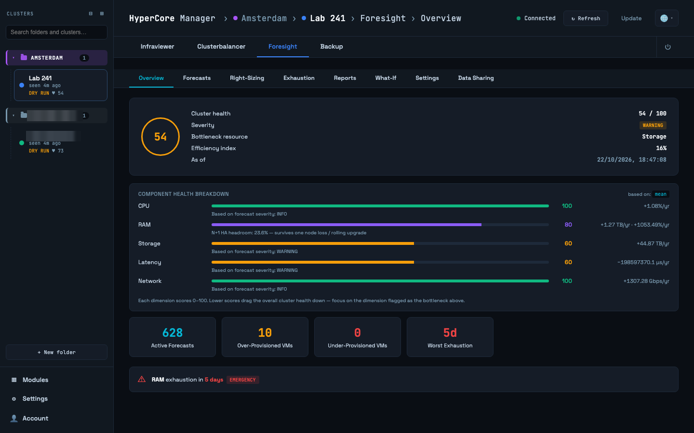
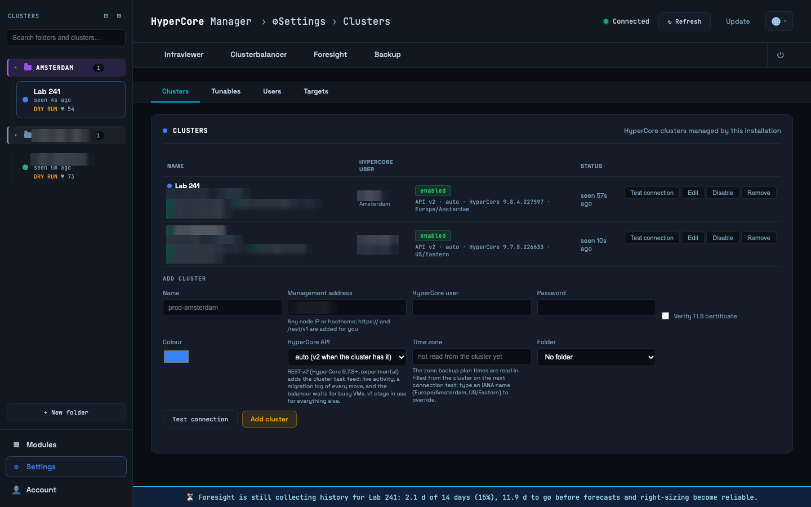

# HyperCore Manager

**Cluster Balancing, Capacity Intelligence & Self-Updating Stack for Scale Computing HyperCore**

> **Community supported · Apache-2.0**
>
> HyperCore Manager is open-source software maintained on a community-supported basis. It is **not** an official Scale Computing product: there is no official support, no SLA, and no guarantee of future releases. Use it at your own risk. Questions, bug reports and feature requests go through [GitHub Issues](https://github.com/wvcollenburg/hypercore-manager/issues). See [CONTRIBUTING.md](CONTRIBUTING.md) for how contributions are handled.

HyperCore Manager is a containerized stack that automatically distributes virtual machine workloads across Scale Computing HyperCore cluster nodes. It monitors resource usage in real time, enforces VM placement rules, and — optionally — uses machine learning to predict and prevent future overloads before they happen.

One installation manages any number of HyperCore clusters. Clusters are registered in the dashboard, grouped into folders, and shown to each user according to the folders they belong to, so a service provider can run one stack for all its customers.



The optional **Foresight** module extends the platform with long-range capacity intelligence: multi-horizon forecasting, VM right-sizing recommendations, cluster health scoring, scenario modelling. The optional **Backup** module schedules VM backups to SMB or NFS targets, with retention and import back into any registered cluster.

---

## Features

### Core Stack

- **Reactive Balancing** — Continuously monitors node CPU and RAM usage via sliding-window averages. When a node exceeds configurable thresholds, the lightest suitable VM is live-migrated to the least-loaded node.
- **Predictive Balancing (The Oracle)** — Uses [Facebook Prophet](https://facebook.github.io/prophet/) to forecast per-VM CPU load 24 hours ahead. Proactively migrates VMs before predicted spikes arrive. Runs in a background thread with parallel workers so the reactive engine is never blocked.
- **Affinity Enforcement** — Highest-priority engine that enforces VM placement rules via HyperCore tags:
  - `node_<suffix>` — Pin a VM to a specific node (e.g. `node_241` pins to the node whose IP ends in `.241`)
  - `anti_<vm_name>` — Prevent two VMs from sharing the same node (e.g. `anti_dc02` on `dc01`)
- **Clusters configured in the tool** — Register one or more HyperCore clusters from the dashboard (Settings → Clusters). Credentials are stored encrypted in PostgreSQL; nothing cluster-specific lives in `.env`. Every view, setting and Foresight analysis is per cluster, and the same physical cluster registered twice is detected and only balanced once.
- **Folders and users** — Clusters live in folders in the sidebar rail (collapsible, colour-coded, searchable by folder, cluster name or address). Administrators see everything; other users see the folders they are members of. Settings, Modules and share management are admin-only; everyone has an Account page with password and two-factor settings.
- **Live Configuration** — All tunable settings are stored in a shared PostgreSQL database. Change any parameter through the dashboard UI at runtime — no container restarts required.
- **Built-in Dashboard** — Web-based UI (port 5000) showing node/VM performance, drive health, VSD I/O, migration event log, balancer settings, and the full Foresight interface. Fully offline-capable for dark-site deployments.
- **Multi-language UI** — English, Dutch, French, and German, selectable from the dashboard header.
- **User Authentication** — Username/password login with optional per-user TOTP (one-time password) two-factor. Auth can be disabled for local/dev use by leaving the dashboard credentials blank.
- **In-app Updater** — Detects new tagged releases on origin and applies them in place with one click; database migrations ship and apply automatically with the release that needs them.
- **Backup** — Incremental VM backups through a backup proxy on the cluster: HyperCore's changed-block tracking tells the proxy which blocks changed, only those are read (no export rate limit) and written as qcow2 chains onto an SMB or NFS target, with a fresh full every N runs and retention by merge. Native HyperCore export remains available as a plan mode. Administrators define targets and proxies once and assign targets to folders; users create plans, browse restore points and run imports without ever seeing a path or a credential.
- **Metrics Collection** — Comprehensive HyperCore telemetry (node performance, VM stats, drive health, VSD I/O, replication, cluster conditions) stored in InfluxDB with automatic downsampling.

### Foresight

- **Capacity Forecasting** — Regression-based forecasts across four horizons (30, 90, 180, 365 days) for CPU, RAM, storage capacity, storage latency, and network throughput. Confidence-scored; low-confidence forecasts are suppressed.
- **VM Right-Sizing** — Detects over- and under-provisioned VMs via three independent signals: sustained CPU usage, storage latency correlation, and recurring CPU spike patterns.
- **Resize Advisor** — Translates right-sizing flags into concrete vCPU change recommendations with confidence scores and risk classifications.
- **Cluster Health Scoring** — Aggregate 0–100 health score derived from forecast trends and right-sizing findings. Severity levels: EMERGENCY, CRITICAL, WARNING, ATTENTION, INFO.
- **What-If Scenario Modelling** — Simulate adding or removing VMs and see the projected impact on cluster health and resource exhaustion timelines.
- **Outcome Tracking** — Polls HyperCore for VM vCPU changes and records whether right-sizing recommendations were acted on, allowing recommendation quality to be measured over time.
- **PDF Reports** — Downloadable capacity reports with optional branding (logo, accent colour, company name).
- **Webhook Alerts** — HMAC-SHA256 signed HTTPS alerts for CRITICAL and EMERGENCY events, with automatic retry.
- **Live Tunables** — All analysis thresholds and toggles are editable from the dashboard at runtime, without restarting Sentinel.

---

## Architecture

```
                 HyperCore clusters (one or many, registered in the dashboard)
                 ┌──────────┐ ┌──────────┐ ┌──────────┐
                 │ cluster A│ │ cluster B│ │ cluster C│ ...   REST API v1
                 └────▲─────┘ └────▲─────┘ └────▲─────┘
        polls 30s     │ live migrations │   backup / import tasks
   ┌──────────────────┼────────────────┼────────────────┼──────────────────┐
   │  Collector       │   Balancer     │   Backup       │   Sentinel       │
   │  one worker      │   one engine   │   scheduler    │   one analysis   │
   │  thread/cluster  │   per cluster  │   + REST 8082  │   engine/cluster │
   └───────┬──────────┴───────┬────────┴───────┬────────┴────────┬─────────┘
           │ metrics          │ events         │ runs            │ conclusions
   ┌───────▼──────────┐   ┌───▼────────────────▼─────────────────▼─────────┐
   │     InfluxDB     │   │                  PostgreSQL                    │
   │ cluster_id-tagged│   │ cluster registry (encrypted creds), folders,   │
   │ 1y + 5y buckets  │   │ users, per-cluster tunables, shares, history   │
   └───────▲──────────┘   └───────────────────────▲────────────────────────┘
           │                                      │
   ┌───────┴──────────────────────────────────────┴────────────────────────┐
   │  Dashboard (port 5000): cluster rail with folders, Infraviewer,       │
   │  Clusterbalancer, Foresight, Backup, Settings, in-app updater         │
   └───────────────────────────────────────────────────────────────────────┘
```

Each service is one container; inside it, one worker per enabled cluster. Registering a cluster
needs no restart and no compose change. Everything stored for a cluster carries its registry id,
so clusters can be added, disabled or removed independently.

| Container    | Role                                                                       |
|--------------|----------------------------------------------------------------------------|
| **Collector**  | Polls HyperCore API, writes metrics to InfluxDB                          |
| **Balancer**   | Decision engine — affinity, reactive, and predictive modes               |
| **InfluxDB**   | Time-series metrics storage with 1-year detailed + 5-year long-term retention |
| **PostgreSQL** | Config store and Foresight conclusions database                      |
| **Dashboard**  | Web UI: cluster rail, monitoring, live configuration, users and folders, Foresight, Backup |
| **Sentinel**   | Foresight capacity analysis, forecasting, and REST API               |
| **Backup**     | Backup scheduler and REST API: plans, restore points, restores, imports |
| **Proxy**      | Backup proxy: reads snapshot clones, writes backup chains (privileged) |

---

## Installation

### Prerequisites

- A Linux host or VM (Ubuntu 22.04+ tested) with **Docker Engine 24+** and **Docker Compose v2**.
  - Compose v2 is the `docker compose` (no hyphen) command. The legacy python `docker-compose` 1.29.x is **not supported** — it has known recreate bugs that break the in-app updater. On Debian/Ubuntu, install via `sudo apt install docker-compose-v2`.
- HyperCore cluster management IP and a service account with read + migration permissions.
- Outbound HTTPS access to the HyperCore REST API (or fully offline — see [Dark-Site Deployment](#dark-site--air-gapped-deployment)).
- ~2 vCPU / 4 GB RAM minimum for the core stack; more for Foresight (see [Resource Requirements](#resource-requirements)).

There are two supported installation paths. Both work equally well on a laptop with Docker Desktop for a trial run as on a dedicated Linux VM; Apple Silicon and other arm64 hosts are supported.

### Method 1 — Manual Docker Compose

For operators running the stack on infrastructure they already manage.

```bash
git clone https://github.com/wvcollenburg/hypercore-manager.git
cd hypercore-manager

cp .env.template .env
# Edit .env — replace every CHANGE_ME (HCM_SECRET_KEY, database secrets, dashboard password)

docker compose up --build -d
```

The dashboard is available at **http://localhost:5000**. Log in, and the first screen asks for
your cluster: management address plus a HyperCore account. Save it and the collector, balancer
and Foresight start on that cluster within a minute. Add further clusters under
Settings → Clusters.

> **Note:** On first startup, the balancer needs ~2.5 minutes to fill its averaging buffers before it begins evaluating the cluster. The dashboard will show data after the first collector cycle (~30 seconds).

### Method 2 — Interactive Curses Installer (Linux/macOS)

`install.py` walks every `.env` setting interactively, explaining each one and generating strong secrets on demand. Pre-fills any existing `.env`. Helpful when you want guided configuration instead of editing the file by hand.

```bash
git clone https://github.com/wvcollenburg/hypercore-manager.git
cd hypercore-manager

python3 install.py
# Then run the docker compose commands shown on the final screen.
```

The installer also detects whether Compose v2 is present on the host and warns if the legacy v1 is in the way. Windows users can run this via WSL, or `pip install windows-curses` first.

### Starting with Foresight

```bash
docker compose up --build -d
```

One command starts everything: the core stack, Sentinel and Backup (with its proxy). A module
you do not use is simply stopped, for example `docker compose stop sentinel` or
`docker compose stop backup proxy`; the dashboard hides the tab of a module that is not running.

> **Note:** Foresight requires at least 14 days of metrics history before meaningful forecasts and right-sizing analysis can be produced.

---

## Configuration

Clusters are registered in the dashboard, never in `.env`. Everything else (database secrets,
ports, the `HCM_SECRET_KEY` that encrypts stored cluster credentials, and the application defaults
below) is defined in `.env`. The defaults are seeded into PostgreSQL on first start as the
**Defaults** template; every cluster you register gets its own copy, editable live in the dashboard
without a restart. Database connection strings and secrets remain environment-only.

### Registering clusters

Settings → Clusters (admin only): name, management address (any node IP or hostname), HyperCore
username and password, and whether to verify the TLS certificate. **Test connection** logs in
and reads the cluster name, node count and HyperCore version before anything is saved. The
balancer account needs rights to live-migrate VMs; read-only accounts work for monitoring and
dry-run. A cluster can be disabled (collection and balancing pause, history stays) or removed
(optionally purging its Foresight history).

**Nodes.** The address you register is only the first contact. HyperCore has no primary node:
every node serves the full REST API, so the collector discovers all nodes of the cluster
(`GET /Node`) and every service keeps one login session on one of them. When that node stops
answering, the service logs in on another node and carries on; the node in use is shown under
the cluster in Settings → Clusters, and nothing moves back when the old node returns. Witness
nodes count as addresses. **Test connection** on a registered cluster logs in on every known
node and reports how many answered. A node that leaves the cluster stays listed greyed out
until an admin forgets it.

If you register a cluster by DNS name and verify TLS, the discovered nodes are addressed by
their reverse-DNS names so each node's own certificate can be verified: make sure every node
has a PTR record and a certificate matching it. Registered by IP, the node IPs are used as they
are.

`HCM_SECRET_KEY` protects the stored passwords. Back it up with the database; if it is lost the
clusters keep working until the next restart, after which their passwords must be re-entered.

### Balancer tunables

Dry-run, thresholds, cooldowns, the Oracle's schedule and the poll intervals are not in `.env`.
They ship with defaults and are edited per cluster under Settings → Tunables, where the
**Defaults** template sets what a newly registered cluster starts with and "apply to all
clusters" pushes a value everywhere. Every cluster starts in dry-run. The settings chapter of
the manual describes each one; the installing chapter has the `.env` reference for everything
that does live there.

### Foresight Tunables

All Sentinel analysis thresholds are live-editable from the Foresight → Settings tab in the dashboard. Key parameters:

| Parameter | Default | Description |
|-----------|---------|-------------|
| `SENTINEL_ANALYSIS_WINDOW_DAYS` | `14` | Lookback window for right-sizing analysis |
| `SENTINEL_CPU_OVER_PROVISIONED_THRESHOLD` | `20.0` | CPU avg % below which a VM is flagged over-provisioned |
| `SENTINEL_CPU_UNDER_PROVISIONED_AVG_THRESHOLD` | `80.0` | CPU avg % above which a VM is flagged under-provisioned |
| `SENTINEL_CPU_UNDER_PROVISIONED_P95_THRESHOLD` | `90.0` | CPU p95 % above which a VM is flagged under-provisioned |
| `SENTINEL_FORECAST_30D_ENABLED` | `true` | Enable/disable 30-day forecast horizon |
| `SENTINEL_FORECAST_90D_ENABLED` | `true` | Enable/disable 90-day forecast horizon |
| `SENTINEL_FORECAST_180D_ENABLED` | `true` | Enable/disable 180-day forecast horizon |
| `SENTINEL_FORECAST_365D_ENABLED` | `true` | Enable/disable 365-day forecast horizon |
| `SENTINEL_ANOMALY_FILTER_ENABLED` | `true` | Enable seasonality-aware outlier suppression |
| `SENTINEL_RETENTION_MONTHS` | `12` | How long conclusions are retained in the database |
| `SENTINEL_OUTCOME_TRACKER_ENABLED` | `true` | Track whether right-sizing recommendations were acted on |
| `SENTINEL_WEBHOOK_ENABLED` | `true` | Send CRITICAL/EMERGENCY alerts via webhook |

---

## VM Placement Tags

Placement rules are defined as tags on VMs in HyperCore — no balancer configuration required.

| Tag Format | Effect | Example |
|------------|--------|---------|
| `node_<suffix>` | Pin VM to the node whose LAN IP ends with `<suffix>` | `node_241` |
| `anti_<vm_name>` | Never place this VM on the same node as `<vm_name>` | `anti_dc02` |

Only one installation may balance a given cluster live. A second HyperCore Manager pointed at
the same cluster must stay in dry-run, otherwise two engines will move VMs against each other.
Within one installation this is enforced automatically (the same cluster registered twice is
detected and the duplicate's balancer suspended); across installations it is an operator rule.

Affinity rules take priority over all other engines. A VM with a `node_` tag will be moved back to its pinned node even if doing so would worsen cluster balance.

---

## Dashboard

The dashboard is a single-page application served on port 5000. The UI is available in **English, Dutch, French, and German** — pick from the language selector in the header. The currently running version is shown in a small footer at the bottom-right of every page.

The left-hand **cluster rail** lists folders and clusters (collapsible, colour-coded, with a search box that matches folder names, cluster names and addresses). The selected cluster drives every tab; breadcrumbs in the header show where you are. The rail footer holds Modules and Settings for administrators and the Account page for everyone.

| Area | Contents | Who |
|------|----------|-----|
| **Infraviewer** | Node CPU/RAM history, drive health and temperature, VM metrics, VSD read/write I/O | everyone (own folders) |
| **Clusterbalancer** | Migration event log (last 7 days, including moves made outside the balancer when REST v2 is in use), reactive and predictive engine settings | everyone (own folders) |
| **Foresight** | Capacity forecasts, right-sizing recommendations, cluster health, reports, what-if modelling, live Sentinel tunables | everyone (own folders) |
| **Backup** | Backup plans, restore points, restores, file recovery and run history for the selected cluster | folder members |
| **Modules** | Auto-discovered InfluxDB measurements for ad-hoc data exploration | admins |
| **Settings** | Clusters, Tunables (per cluster / Defaults / all), Users, Targets | admins |
| **Account** | Own password and TOTP two-factor | everyone |
| **Manual** | This user manual, served by the dashboard at `/manual` (opens in a new tab; works offline) | everyone |

<table>
<tr>
<td width="50%"></td>
<td width="50%"></td>
</tr>
<tr>
<td width="50%"></td>
<td width="50%"></td>
</tr>
</table>

Screenshots were taken on a three-node lab cluster; the [user manual](docs/manual/README.md) has one per panel.

Users have one of two roles. **Administrators** see every cluster and manage clusters, folders,
users and shares. **Users** see the clusters in the folders they are members of and can operate
them (settings, backup plans, imports) but cannot manage the installation. Folder menus in the rail
(the "…" button) move clusters between folders, edit members and assign a backup target. See
[docs/administration.md](docs/administration.md) for the full walkthrough.

To run without authentication (local/dev), leave `SC_DASHBOARD_USER` blank in `.env`; everyone is then an administrator.

On first login each user sees a one-time notice explaining that this is community-supported software and where to report issues. The acknowledgement is stored per user; when auth is disabled it is stored in the browser instead.

---

## Foresight in Detail

Foresight (the `sentinel` container) runs five independent background loops:

1. **Connectivity loop** — lightweight InfluxDB ping every 5 minutes
2. **Analysis loop** — full capacity analysis every hour: forecasting, right-sizing, resize advice, cluster health scoring. Queries InfluxDB on demand and frees all data after each cycle to keep memory usage flat.
3. **Pruning loop** — every 15 minutes, drops conclusions for VMs that no longer exist on the cluster and enforces the retention window
4. **Outcome loop** — polls HyperCore every 6 hours for VM vCPU changes and records whether right-sizing recommendations were followed
5. **Webhook loop** — dispatches CRITICAL and EMERGENCY alerts every 60 seconds via outbound HTTPS POST (HMAC-SHA256 signed, retry schedule: 5 min, 30 min, dead-letter)

### REST API

Sentinel exposes a REST API on port 8081 (internal to the Docker network; proxied through the dashboard). Authentication is optional via `SENTINEL_API_TOKEN`.

| Endpoint | Description |
|----------|-------------|
| `GET /api/v1/forecasts` | Latest capacity forecast snapshots |
| `GET /api/v1/rightsizing` | Right-sizing findings per VM |
| `GET /api/v1/resize` | Concrete vCPU resize recommendations |
| `GET /api/v1/cluster-health` | Cluster health score and breakdown |
| `GET /api/v1/exhaustion` | Resource exhaustion alerts |
| `GET /api/v1/summary` | Single-call overview |
| `POST /api/v1/whatif` | Scenario simulation |
| `GET /api/v1/outcomes` | Right-sizing outcome history |
| `GET /api/v1/tunables` | Live analysis settings |
| `PUT /api/v1/tunables` | Update live analysis settings |

---

## Backup

The `backup` container schedules VM backups, restores and imports, driven from the **Backup**
tab (shown only when the container is running). Incremental backups go through the `proxy`
container, which must run on a VM inside the cluster it serves (the stack VM itself, or a proxy
VM deployed from the dashboard for a remote cluster); HyperCore's native export remains
available as a plan mode.

- **Targets (admin).** Settings → Targets holds the share URIs (`smb://nas.local/share/path` or
  `nfs://nas.local/export/path`) and their credentials, stored encrypted. A target is assigned to a
  folder from the folder's menu in the rail: one target for everyone, or one per tenant, as you
  prefer. Users never see a path or a password; a location is shown as `Target / Folder / vm`.
- **Plans.** Per VM: copies to keep, daily run time (in `TZ`), optional qcow2 compression. The
  destination follows from the cluster's folder. Every run writes to
  `<target>/<folder name>/<vm-name>_YYYYMMDD-HHMMSS/`: the share mirrors your HyperCore Manager
  folders, so an MSP can set per-tenant permissions on the share and an import can only pick up
  copies from the cluster's own folder. The tenant folder is created over SMB when missing;
  HyperCore creates the VM folder itself. Spaces in folder names become underscores on the share.
  Clusters without a folder use `no_folder` and the target flagged as default for them (the "No
  folder" group in the rail has the same Backup target menu).
- **Retention.** After a successful run, older copies of that VM beyond the retention count are
  deleted, oldest first. SMB targets are pruned over the protocol with the stored credentials; for
  NFS, bind-mount the share into the `backup` container and set the prune path on the target.
  Other VMs' folders are never touched.
- **Imports.** Browse the folder's subtree on the target, pick a copy, optionally rename, and
  import into the selected cluster. A name that already exists on the target cluster is refused.
- **Who may do what.** Members of a folder create plans and run imports for its clusters;
  administrators manage targets and the folder assignment.
- **Runs.** Backup and import history with live progress from HyperCore's task API. A run
  interrupted by a container restart is re-attached by its task tag.
- **Rights.** The cluster account registered in Settings → Clusters needs the HyperCore rights
  Backup, Media Management, VM Create/Edit, VM Delete and VM Power Controls; a read-only account
  gives a clear 403 on the first run. Share usernames may be `user`, `DOMAIN\user` or `user@domain`.
- **Share access from a laptop stack** works over SMB without any mount (userland client).

Administration details (targets, folder assignment, rights) are in
[docs/administration.md](docs/administration.md).

## Updates

The dashboard includes an in-app updater that detects new releases and applies them in place. It compares the running version (read from the `VERSION` file at the repo root) against the latest semver-style git tag on `origin`, and surfaces an "Update available" badge in the header when a newer release exists.

- Versioning follows [Semantic Versioning 2.0.0](https://semver.org/): MAJOR when configuration, stored data or the upgrade path change incompatibly, MINOR for features, PATCH for fixes and documentation. The changelog lists upgrade notes per release; read them before clicking Apply Update across a MAJOR boundary.
- Releases are tagged in git as `vMAJOR.MINOR.PATCH` and announced on [GitHub Releases](https://github.com/wvcollenburg/hypercore-manager/releases). Untagged commits don't trigger update prompts — only deliberate releases do, so customers are never bombarded with "update available" for in-flight development.
- Database migrations under `postgres/init/` are applied automatically on dashboard startup; every script is idempotent (`CREATE TABLE IF NOT EXISTS` and similar guards) so existing installs never lose data when a new migration ships.
- The updater works against the checkout's own git origin; nothing about the repository location is built in. It recreates the application services only and leaves InfluxDB and PostgreSQL running.
- Manual update path (equivalent to clicking Apply Update in the dashboard): `git pull && docker compose up --build -d`.

---

## Dark-Site / Air-Gapped Deployment

```bash
# On an internet-connected machine:
docker compose build
docker save $(docker compose config --images) -o hypercore-balancer-images.tar

# On the air-gapped machine:
docker load -i hypercore-balancer-images.tar
docker compose up -d
```

The entire stack runs fully offline once images are built. No outbound connections are required.

---

## Resource Requirements

The core stack (Collector, Balancer, Dashboard, InfluxDB, PostgreSQL) is lightweight. Foresight (Sentinel) adds significant memory during analysis cycles due to time-series data processing; it releases memory immediately after each cycle.

Sizing is by the **total number of VMs across all registered clusters**: each service runs one worker per cluster inside the same container, so ten clusters of 20 VMs behave like one cluster of 200. Raise the `memory:` limits of `balancer` and `sentinel` in `docker-compose.yaml` accordingly; the collector and backup containers stay small.

### Core Stack

| VMs  | Min. vCPUs | Recommended RAM | Disk (1 yr) |
|------|-----------|-----------------|-------------|
| 5    | 2         | 1 GB            | 2 GB        |
| 50   | 2         | 1 GB            | 12 GB       |
| 100  | 2         | 2 GB            | 23 GB       |
| 500  | 4         | 4 GB            | 112 GB      |

### Foresight (Sentinel) — Peak Analysis Memory

Sentinel queries InfluxDB on demand and frees all data after each analysis cycle. Peak usage occurs during the analysis window and depends on the number of managed VMs and the `SENTINEL_ANALYSIS_WINDOW_DAYS` setting (default 14 days).

| VMs | Estimated Peak |
|-----|----------------|
| 25  | ~350 MB        |
| 100 | ~1.2 GB        |
| 250 | ~3 GB          |
| 500 | ~6 GB          |

Sentinel's memory limit in `docker-compose.yaml` should be sized to cover the peak for your VM count. Between analysis cycles, idle memory returns to ~100 MB.

> **Note on CPU throttling:** The CPU limits in `docker-compose.yaml` are tuned for a 2-core shared host. On a dedicated VM with 4+ CPUs, remove the `cpus:` limits from all services. InfluxDB in particular suffers badly from CPU quota throttling — Flux queries are bursty and multi-threaded, and hitting the quota causes repeated pause/resume cycles that can turn sub-second queries into 10+ second waits. See [the installing chapter of the manual](docs/manual/08-installing-and-updating.md#what-you-need).

---

## Bring your own Grafana

The stack no longer ships Grafana. If you want one, point your own instance at InfluxDB with the
Flux query language: URL `http://<stack host>:8086`, organisation and bucket from `.env`
(`INFLUX_ORG`, `INFLUX_BUCKET`, long-term data in `INFLUX_LONGTERM_BUCKET`), and a read-only
token created in the InfluxDB UI rather than the admin token the services use. Every measurement
carries a `cluster_id` tag.

---


## Project Structure

```
├── docker-compose.yaml
├── .env.template
├── VERSION                          # Single line: current version (e.g. 1.0.0)
├── LICENSE                          # Apache License 2.0
├── NOTICE
├── README.md
├── CONTRIBUTING.md                  # How issues and contributions are handled
├── SECURITY.md                      # How to report a vulnerability
├── CHANGELOG.md
├── install.py                       # Interactive curses installer (Linux/macOS)
├── installer/
│   └── core.py                      # .env schema, validation, autogen helpers
├── shared/                          # single source for modules copied into each service
│   ├── cluster_registry.py          # config.clusters access, credentials, connection test
│   ├── hcm_crypto.py                # Fernet encryption keyed by HCM_SECRET_KEY
│   └── config_db.py                 # per-cluster live tunables
├── tools/
│   └── sync_shared.py               # copies shared/ into the service directories
├── tests/                           # pytest suite (unit + optional integration)
├── .github/                         # CI workflow and issue templates
├── docs/
│   ├── administration.md            # Clusters, folders, users, targets, backup: the admin guide
│   ├── hypercore-openapi-v1.json    # HyperCore REST v1 spec (contract-tested)
│   └── hypercore-openapi-v2.json    # HyperCore REST v2 spec (experimental)
├── influxdb/
│   ├── Dockerfile
│   └── init.sh                      # Creates long-term bucket and downsampling tasks
├── postgres/
│   ├── Dockerfile
│   └── init/                        # SQL migration scripts (idempotent, auto-applied)
├── Collector/
│   ├── Dockerfile
│   ├── requirements.txt
│   ├── config_db.py                 # Shared live-config module (PostgreSQL backed)
│   └── collector.py                 # HyperCore polling and InfluxDB writes
├── Balancer/
│   ├── Dockerfile
│   ├── requirements.txt
│   ├── config_db.py
│   ├── HyperCore_balancer.py        # Main decision engine (affinity, reactive, predictive)
│   └── predictive_engine.py         # The Oracle (Prophet forecasting)
├── dashboard/
│   ├── Dockerfile
│   ├── requirements.txt
│   ├── config_db.py
│   ├── migrations.py                # DB migration runner (idempotent)
│   ├── versioning.py                # semver helpers for the updater
│   ├── user_db.py                   # users, passwords, TOTP
│   ├── app.py                       # Flask API, Sentinel proxy, in-app updater
│   └── static/
│       ├── index.html               # Single-page dashboard
│       └── lang/                    # English, Dutch, French, German translations
├── backup/
│   ├── Dockerfile
│   ├── backup.py                    # Entry point — scheduler + REST API (port 8082)
│   ├── jobs.py                      # Backup/import jobs, share layout, SMB pruning, restart recovery
│   ├── scheduler.py                 # APScheduler wiring (daily cron per plan)
│   ├── api.py                       # REST API proxied by the dashboard
│   ├── hypercore.py                 # HyperCore export/import/task calls
│   ├── vm_definition.py             # libvirt XML generated from the VM record (templates in vm_definitions/)
│   └── db.py                        # PostgreSQL schema `backup` (plans, runs, imports, targets)
└── sentinel/
    ├── Dockerfile
    ├── requirements.txt
    ├── sentinel.py                  # Entry point — four background loops
    ├── api.py                       # REST API (port 8081)
    ├── analysis/                    # Forecasting, right-sizing, cluster health, what-if
    ├── collector/                   # Per-component data collection (nodes/VMs/storage)
    └── reports/                     # PDF report generation with branding
```

---

## Documentation

| Document | Contents |
|----------|----------|
| [docs/manual/README.md](docs/manual/README.md) | User manual: one chapter per module (Infraviewer, Clusterbalancer, Foresight, Backup, Settings, Modules and Account) with screenshots |
| [docs/manual/08-installing-and-updating.md](docs/manual/08-installing-and-updating.md) | Installing and updating: prerequisites, the installer, every `.env` variable, the backup proxy's host, hardening, backing up the installation, upgrading (including from 0.9.x), health checks, troubleshooting |
| [docs/administration.md](docs/administration.md) | Day-to-day administration: registering clusters, folders and members, users and roles, backup targets and layout |
| [docs/hypercore-openapi-v1.json](docs/hypercore-openapi-v1.json) | Scale Computing HyperCore REST API v1 OpenAPI spec (the API every service uses); `tests/test_hypercore_spec_contract.py` checks our calls against it |
| [docs/hypercore-openapi-v2.json](docs/hypercore-openapi-v2.json) | HyperCore REST API v2 (experimental) spec; adds task listing used for the planned activity feed |
| [CONTRIBUTING.md](CONTRIBUTING.md) | Filing good issues, running the stack locally, how code contributions are handled |
| [SECURITY.md](SECURITY.md) | Reporting a vulnerability |
| [CHANGELOG.md](CHANGELOG.md) | Release history |
| [LICENSE](LICENSE) | Apache License 2.0 |

---

## Related Projects

| Repository | Description |
|------------|-------------|

---

## Disclaimer

**USE AT YOUR OWN RISK.** HyperCore Manager is community-supported software, not an official Scale Computing product. It is provided "as is" without warranty of any kind, express or implied, and without any official support or service-level commitment. Neither the authors nor Scale Computing accept responsibility or liability for any damage, data loss, downtime, or other consequences resulting from its use. Every cluster starts in dry-run; test the balancer there before switching it to live in the dashboard.

## License

Copyright (c) 2026 Scale Computing.

Licensed under the Apache License, Version 2.0. You may obtain a copy of the License at http://www.apache.org/licenses/LICENSE-2.0. Unless required by applicable law or agreed to in writing, software distributed under the License is distributed on an "AS IS" BASIS, WITHOUT WARRANTIES OR CONDITIONS OF ANY KIND, either express or implied. See [LICENSE](LICENSE) for the full text and [NOTICE](NOTICE) for attribution.
