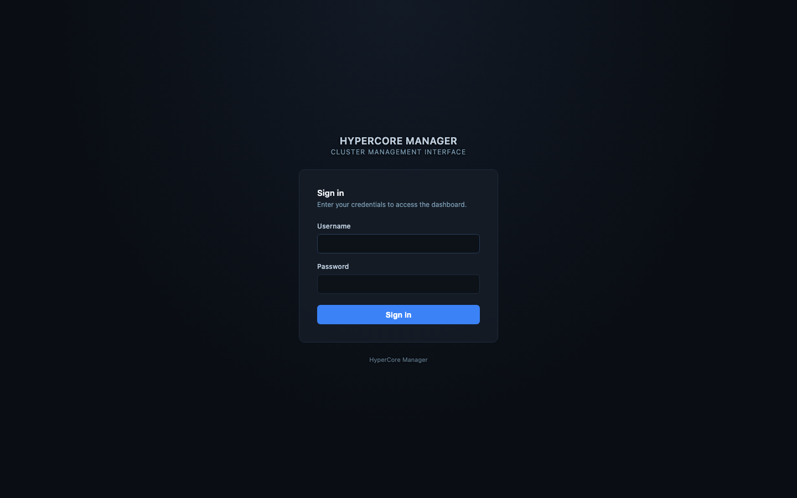

# Getting around

**Logging in.** The dashboard runs on port 5000. Log in with the user name and password an
administrator gave you; if your account has two-factor authentication, the one-time code is
asked next. On the first login everyone sees a one-time notice that this is community-supported
software and where to report issues.

**The rail.** The left-hand rail lists folders and the clusters in them. Folders collapse, carry
a colour, and the search box at the top matches folder names, cluster names and addresses.
Under each cluster you see when it was last seen, whether its balancer runs in dry-run or live,
and its health score once Foresight has one. Click a cluster to select it; every tab then shows
that cluster. Administrators can create folders and move clusters between them from the folder
menu (the "…" button); users see only the folders they are members of.

**The tabs.** Across the top: Infraviewer, Clusterbalancer, Foresight and Backup, each with its
own sub-panels. The rail footer holds Modules and Settings (administrators) and Account
(everyone). The header shows the breadcrumb, the connection state to the backend, a Refresh
button, the updater's state for administrators, and the language selector: English, Dutch,
French and German.

**Reading the screens.** Every chart is live and refreshes on its own every 30 seconds; the
time range selectors on a tab apply to that tab. A grey badge or a dash means no data yet: a
cluster registered minutes ago has no history, and Foresight needs 14 days before its forecasts
are reliable. The footer bar says how far that collection has come.

**Nothing here changes the cluster by itself** except two things that are clearly marked: the
Clusterbalancer, when it is switched out of dry-run, live-migrates VMs; and a restore in the
Backup tab creates a VM. Everything else reads.
