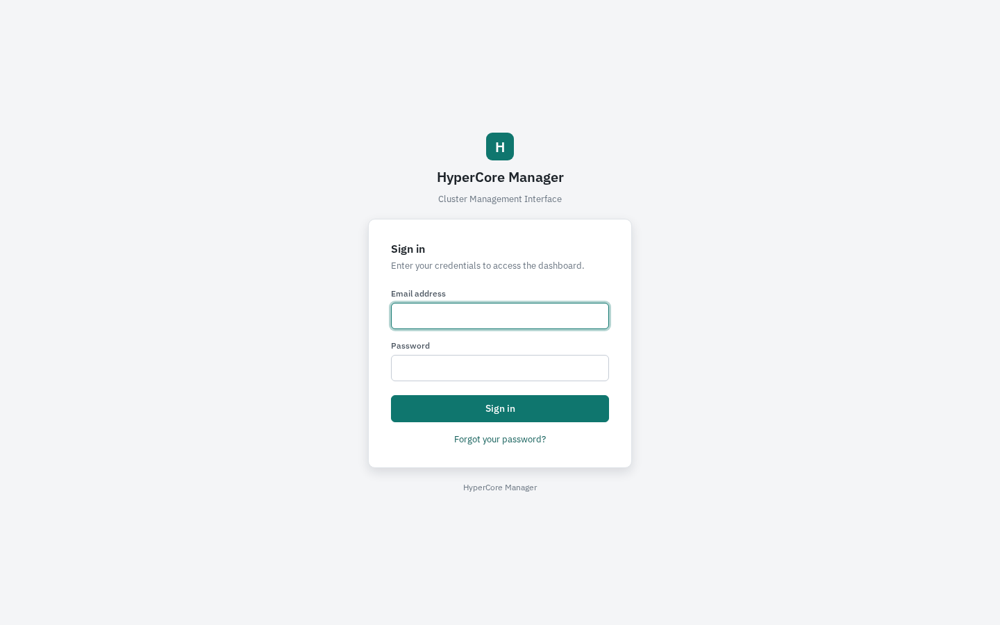

# Getting around

**Logging in.** The dashboard runs on port 5000. Log in with your email address and your password;
a new account chooses its password through the invitation mail (the initial administrator logs in
with its username); if your account has two-factor authentication, the one-time code is
asked next. On the first login everyone sees a one-time notice that this is community-supported
software and where to report issues.

**The rail.** The left-hand rail lists folders and the clusters in them. Folders collapse, carry
a colour, and the search box at the top matches folder names, cluster names and addresses.
Under each cluster you see when it was last seen, whether its balancer runs in dry-run or live,
and its health score once Foresight has one. Click a cluster to select it; every tab then shows
that cluster. Folders sit in the tenant tree (MSP › customer › folder, Settings → Access → Tenants);
whoever may manage them there can create folders and move clusters between them from the folder
menu (the "⋯" button). You see only the folders and clusters your roles reach.

**Alert badges.** Next to a cluster's name, coloured badges count what is wrong on it right now,
in the order and colours of HyperCore's own cluster header: red ✕ critical, orange ⚠ warning,
yellow ? notice, blue i info. Only badges with a count show. They carry the cluster's active
HyperCore conditions (a failed drive, a node low on memory; HyperCore's own descriptions, in
English), a cluster update that HyperCore terminated, and VM consoles left logged in (see
Settings → Console). Click a badge for the list: node, description and since when, per line.
**Mute for N days** hides one line for everybody until then (who muted it is shown in the
collapsed *Muted* group); if it comes back after the mute ran out, it shows again. **History**
lists past conditions with their start, end and duration, filtered by severity and period.
The badges are an overview, up to five minutes behind the cluster, not an alarm: HyperCore's
own e-mail and syslog alerts stay the place for that.

**The tabs.** Across the top: Infraviewer, Clusterbalancer, Foresight and Backup, each with its
own sub-panels. The rail footer holds Modules and Settings (for whoever holds a permission
behind one of their panels) and Account (everyone). The header shows the breadcrumb, the connection state to the backend, a Refresh
button, the updater's state for administrators, and the language selector: English, Dutch,
French and German.

**Reading the screens.** Every chart is live and refreshes on its own every 30 seconds; the
time range selectors on a tab apply to that tab. A grey badge or a dash means no data yet: a
cluster registered minutes ago has no history, and Foresight needs 14 days before its forecasts
are reliable. The footer bar says how far that collection has come.

**What changes the cluster.** Most of the dashboard only reads. What writes is marked and needs its
own permission: the Clusterbalancer, once switched out of dry-run, live-migrates VMs; a VM's **Edit**,
power actions, snapshots, clones and **New VM** (Infraviewer); a **Console** session; backups (a snapshot
per run) and restores (a new VM); test restores, which create a temporary VM, start it and delete it
again; and deploying or removing a backup proxy VM. Changes that need the VM off ask first and can be
scheduled; deletions ask for the name.

**Setting up a new installation?** [Getting started](01a-getting-started.md) walks through the tenant
tree, the first cluster and the first users, step by step.
