# Getting started

This chapter sets up an installation from scratch:
1. an MSP;
2. a customer;
3. a folder;
4. a cluster in that folder;
5. a user with access to all of it.

Each step has a screenshot. The numbered amber markers show what to click, in order. The
[administration guide](../administration.md) covers every option in more detail.

You need an account that is **Admin on the whole installation**. On a new installation that is
the initial administrator from `.env` (`SC_DASHBOARD_USER`).

**Why the tree comes first.** In HyperCore Manager access is always given *on* something: an
MSP, a customer, a folder, a cluster, the VMs with a tag, or one VM. A new user starts with
their first access, so the place you give it on has to exist first. That is why this walkthrough
builds the tree first and adds the user last.

The example builds the MSP **Example IT**, the customer **Acme**, the folder **Production** and
the cluster **Acme-Prod**, then gives **jane@acme.example** access to them. Use your own names.

## 1. Open the tenant tree

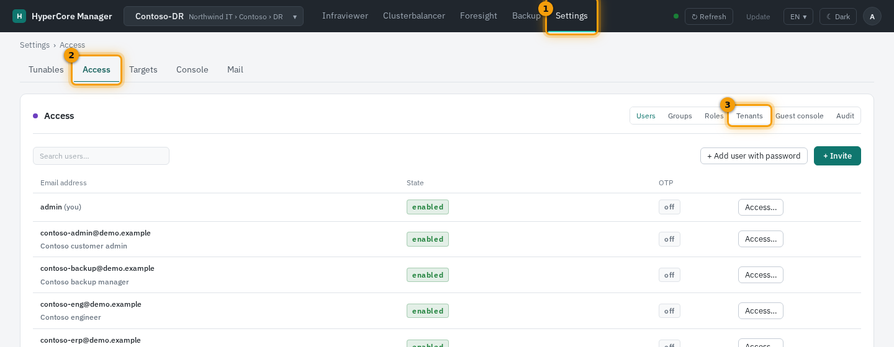

Open the tenant tree:
1. Click **Settings** in the top bar.
2. Click **Access**.
3. Click **Tenants**.

The tree is shown as columns, like a file browser: MSPs, then a selected MSP's customers, then a
customer's folders, then a folder's clusters. The pane on the right shows who has access to
whatever you selected.

**One company or several?** A new installation starts as a single company: the MSP and customer
levels exist but are hidden, and you only see folders.
- **If you run HyperCore Manager for your own company only,** skip steps 2 and 3. Add folders with
  **+ Folder** in the folder column (or **+ New folder** at the bottom of the cluster list, under the cluster switcher) and continue at
  step 4.
- **If you serve customers,** continue with step 2.

## 2. Add the MSP

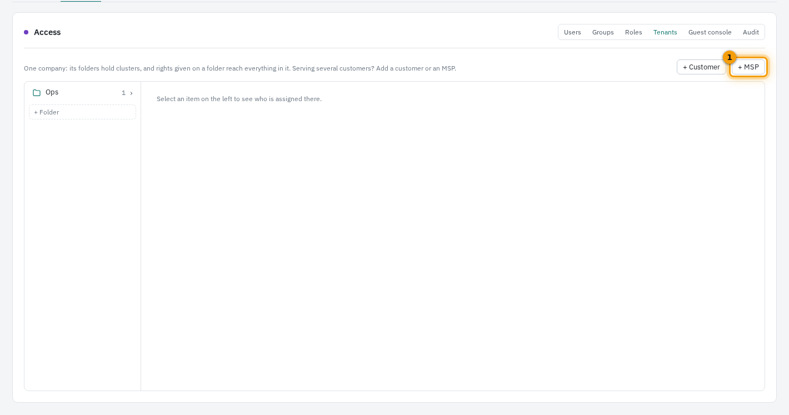

On a new installation, click **+ MSP** at the top of the Tenants tab (1) and confirm. The MSP and
customer levels now show everywhere: in Access, in the cluster list and in paths.

Folders and clusters that already existed stay where they were, under the customer **Default** in
the MSP **Default**. Rename those to your own company later (select it, then **Rename** in the
pane), or move their clusters into the new tree.

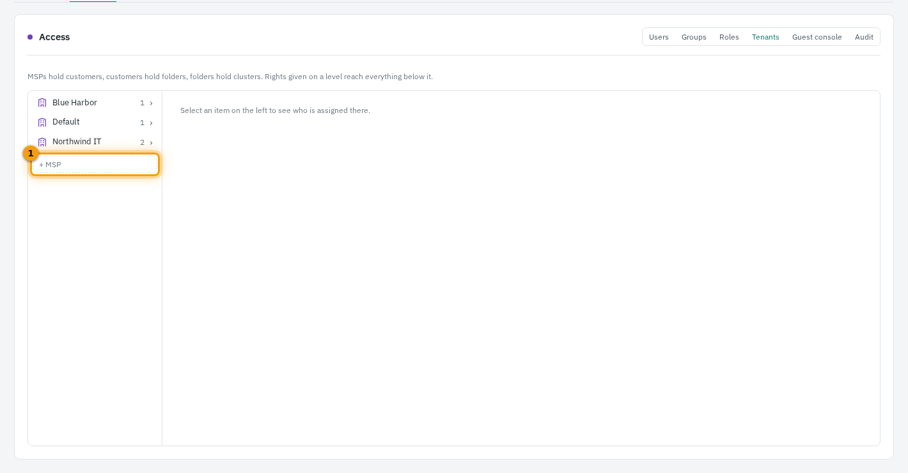

Once the levels show, **+ MSP** sits at the foot of the MSP column (1). Use it for every further
MSP.

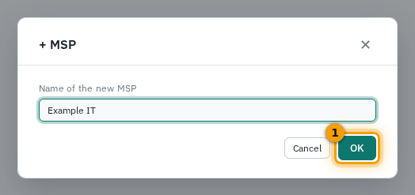

Type the name, **Example IT**, and click **OK** (1).

## 3. Add the customer

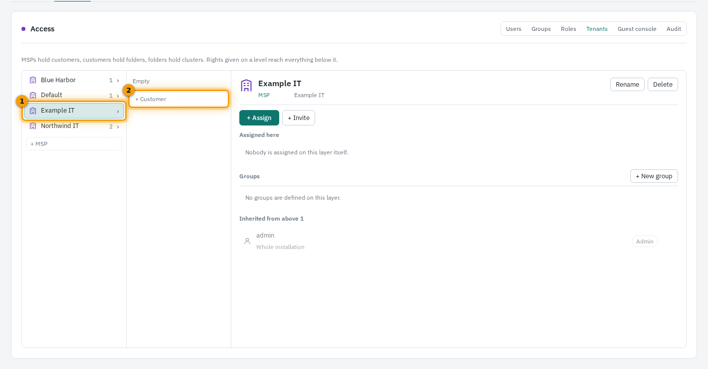

1. Select **Example IT** in the first column. Its customers appear in the second column, which is
   still empty.
2. Click **+ Customer** at the foot of that column, type **Acme** and click **OK**.

## 4. Add the folder

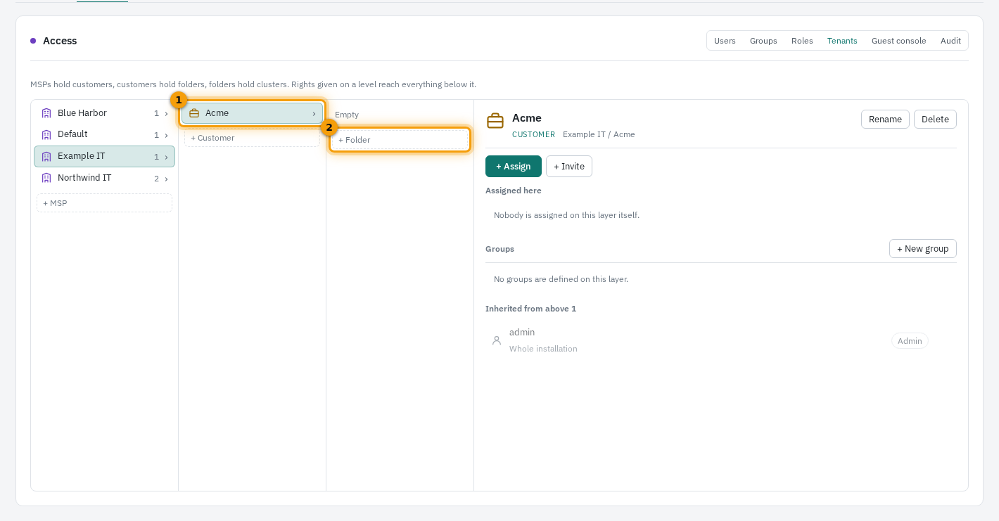

1. Select **Acme**.
2. Click **+ Folder** at the foot of the folder column, type **Production** and click **OK**.

A folder groups the clusters that belong together. It is also where the backup target is set (the
folder menu "⋯" in the cluster list → **Backup target**). If the customer has a DR cluster, give it a folder of
its own or put it in this one with the role **DR**; see the Backup chapter.

## 5. Add the cluster

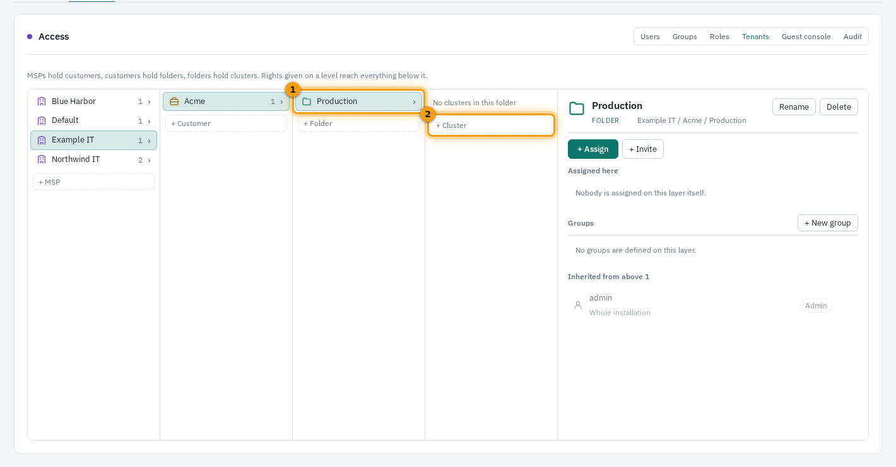

1. Select **Production**. The last column lists its clusters, which is still empty.
2. Click **+ Cluster** at its foot.

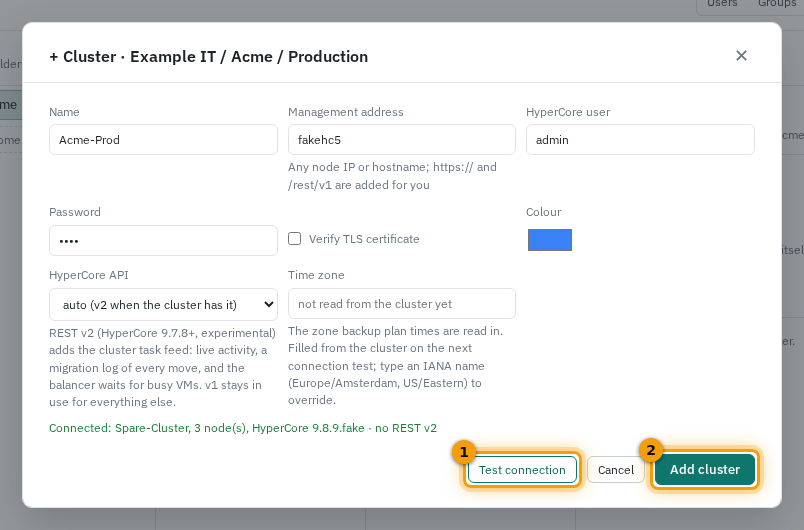

Fill in the dialog:

| Field | What to enter |
|---|---|
| Name | **Acme-Prod**; unique within the folder |
| Management address | Any node's IP address or host name; `https://` and `/rest/v1` are added for you |
| HyperCore user, Password | A HyperCore account; the administration guide lists the rights each feature needs |
| Verify TLS certificate | On if the cluster has a trusted certificate |

The other fields can stay as they are.

1. Click **Test connection**. It logs in and shows the cluster name, the number of nodes and the
   HyperCore version, in green under the fields.
2. Click **Add cluster**.

Within a minute the cluster appears in the cluster switcher and the first charts fill. The balancer starts in
**dry-run**: it only logs what it would do. Switch dry-run off later in Clusterbalancer once you
have checked its settings.

The HCM host needs TCP 443 to every node of the cluster; see [Connectivity](09-connectivity.md).

**A cluster you registered at first login** may show under **No folder**. Select it in the tree,
click **Edit**, and pick the folder.

## 6. Add the user

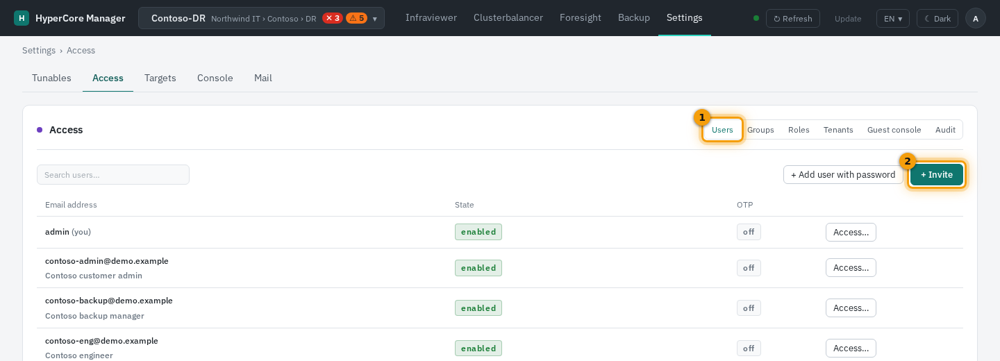

1. Go to the **Users** tab.
2. Click **+ Invite**.

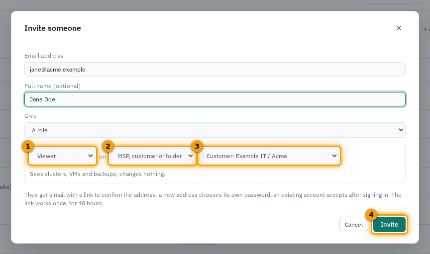

Type the **Email address** (jane@acme.example), which is also the login. **Full name** is
optional. Then give Jane her first access:
1. **Viewer** as the role.
2. **MSP, customer or folder** as the kind of place.
3. **Customer: Example IT / Acme** as the place.
4. Click **Invite**.

Jane gets a mail with a link. She confirms her address and chooses her own password; the link works
once, for 48 hours. Open invitations are listed under the users, with **Resend** and **Withdraw**.
Without a mail server (Settings → Mail) you get the link to pass on yourself.

You can also invite straight from the tree: select the layer and click **+ Invite** in the pane.

Administrators of the whole installation can use **+ Add user with password** instead, for a test
or service account. It asks for the same first access.

## 7. Give rights on the entities

Access given on a layer reaches everything below it. Jane's **Viewer** on Acme already lets her
see every folder, cluster, VM and backup of Acme. Now give her more where she needs it.

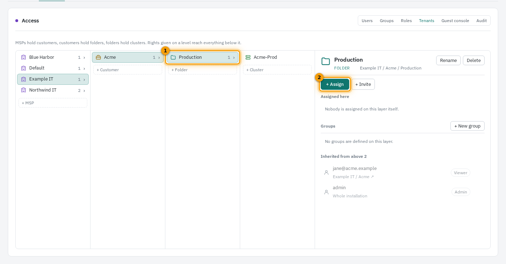

Go back to the **Tenants** tab:
1. Select the layer, here the folder **Production**.
2. Click **+ Assign** in the pane.

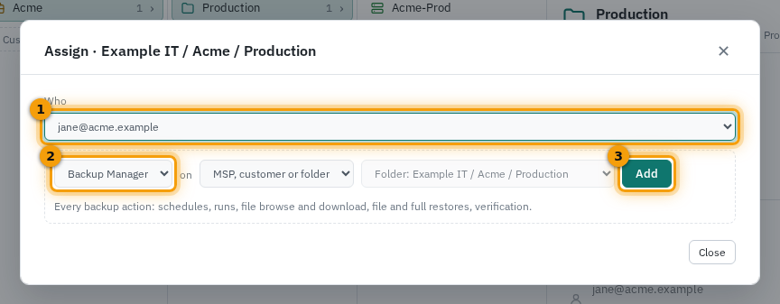

1. Pick Jane under **Who**.
2. Pick the role, here **Backup Manager**. The place is already the layer you selected.
3. Click **Add**.

Do the same on the cluster **Acme-Prod** with the role **Engineer**. Jane now has:

| Layer | Role | Effect |
|---|---|---|
| Acme | Viewer | Sees everything of Acme, changes nothing |
| Production | Backup Manager | Runs backups, restores and file recovery for every cluster in Production |
| Acme-Prod | Engineer | Full VM control on that cluster: console, power, edit, snapshot, clone, create, delete |

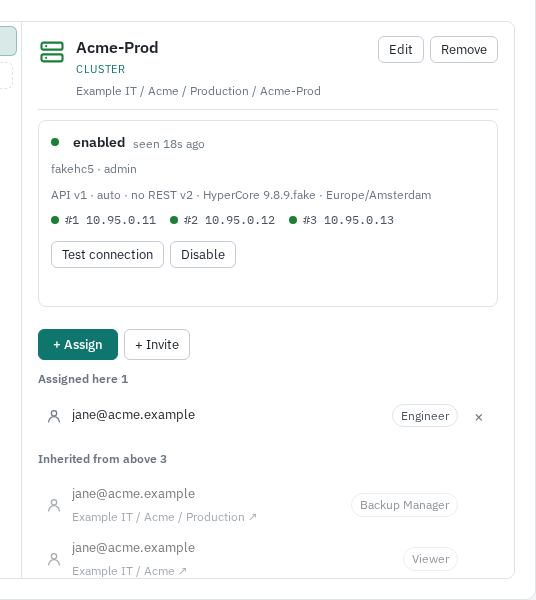

Select **Acme-Prod** to check. Under **Assigned here**, Jane has Engineer. Under **Inherited from
above**, she has Backup Manager from Production and Viewer from Acme, each with a link (↗) to the
layer it comes from.

A cluster also offers **VMs with a tag** and **One VM** as the place to apply a role. Use them for
someone who should only reach some of the VMs (for example App Manager on the VMs tagged `erp`). Such
a person sees those VMs in the cluster's VM list, but not the nodes, the balancer or Foresight.

**To let Acme manage its own people,** give someone **Admin** on Acme. They can then invite users,
create folders, register clusters and assign roles inside Acme, and they never see Example IT or
other customers. Nobody can give a right they do not hold themselves, and nobody changes their own
access.

## 8. What Jane sees

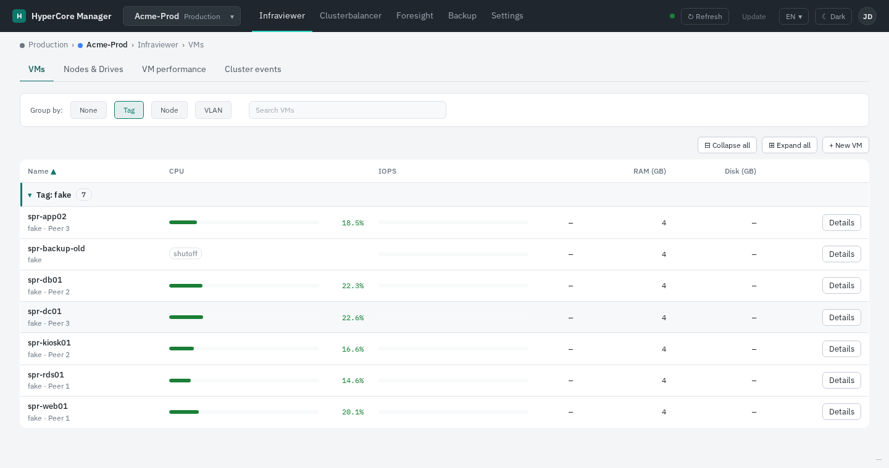

When Jane logs in, she sees only Acme's cluster, with the tabs her roles allow: Infraviewer,
Clusterbalancer, Foresight and Backup, and Settings for the panels she may see there. As Engineer she also gets **+ New VM** and the **Edit** and
**Console** buttons. **Access…** on Jane in the Users tab lists all her access in one place.

## Next steps

- **Backups:** add a backup target and assign it to the folder, then deploy a proxy for the cluster
  (Settings → Targets; see [Backup](05-backup.md) and the administration guide).
- **Mail:** configure a mail server under Settings → Mail, so invitations and alerts go out by
  themselves.
- **Your own roles:** **Copy** a built-in role under Access → Roles to make one with exactly the
  permissions you want.
- **Groups:** for several people with the same access, create a group on the layer, give the group
  the access, and add people to it.
