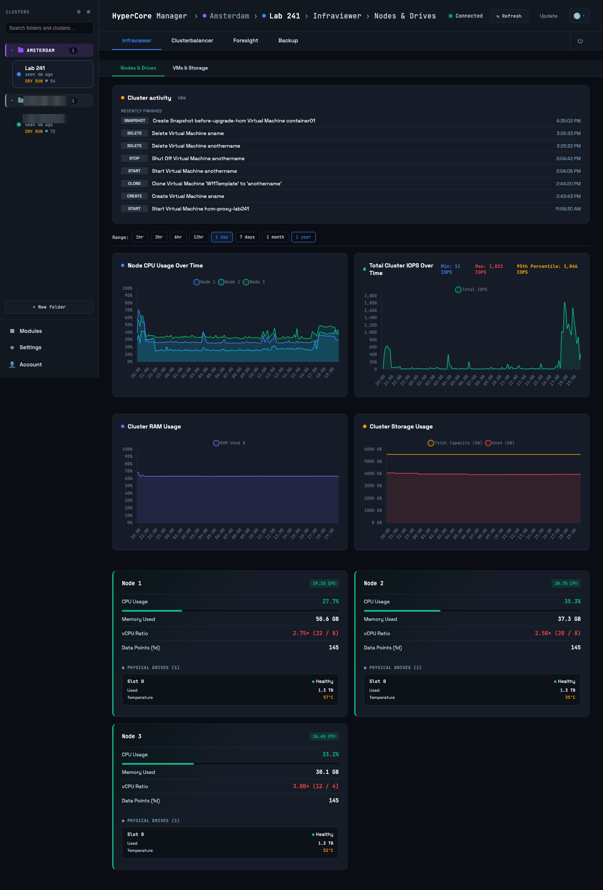
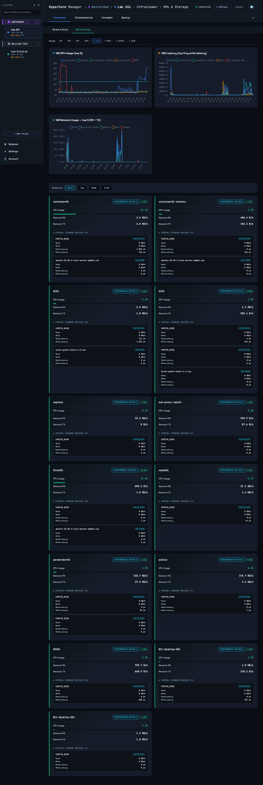

# Infraviewer

Infraviewer is the live view of the selected cluster, in four tabs: **VMs** (the list, where
selecting a cluster always lands), **Nodes & Drives**, **VM performance** (the VM charts) and
**Cluster events** (HyperCore's task feed). Nodes come second on purpose: they matter when
something is wrong, and that is fixed on the cluster itself; the alert badges on the cluster card
say when it is.

## Cluster activity

The strip above the panels shows the tasks the cluster itself is running: exports, imports,
snapshots, migrations, with progress. It comes from HyperCore's task feed and needs the REST v2
switch (Settings → Clusters, API version; HyperCore 9.7.8 or later). Moves made by anything
other than this tool show up here too, which is how you notice another balancer or an
administrator working on the same cluster.

## Nodes & Drives

Pick a range (one hour up to a year) and read the four charts: CPU usage per node over time,
the cluster's total IOPS with its minimum, maximum and 95th percentile for the range, the
cluster's RAM usage, and storage capacity against what is used. Below them one card per node:
current CPU usage, memory used, the vCPU ratio as allocated vCPUs against physical cores (red
once it exceeds the balancer's `MAX_VCPU_RATIO`), how many samples the range holds, and the
node's physical drives with slot, health, used capacity and temperature. A drive turns amber
when HyperCore reports it degraded. A node whose data has not been refreshed within the stale
limit (Settings → Tunables, general) gets a warning marker; that usually means the collector
cannot reach the cluster or the node is down. A witness node or a node in maintenance is shown
as such and never receives VMs.

## VMs & Storage

Every running VM of the cluster on one line: name (with its tag, peer and VLAN), CPU usage,
IOPS over all its disks, memory and total disk size in GB. Click a column header to sort by it.
The list is grouped by tag unless you pick node, VLAN or no grouping; click a group's header to fold
it (Collapse all / Expand all above the list), and the dashboard remembers both choices. The
search field next to the grouping matches anything HyperCore knows about a VM: name, every tag,
description, guest IP and MAC addresses, VLAN, mounted ISO, disk names, OS, node. Several words
must all match ("infraservices dc"); Esc or switching cluster clears it. **Details** opens the VM's
window: what HyperCore says about the VM right now (state, node, OS, firmware, machine and CPU
type, guest agent, node affinity, snapshots and schedule, boot order, tags, every disk, every
network card with its MAC and the IP addresses the guest agent reports) on its **Details** tab,
and on its **Performance** tab CPU, network, and per-disk IOPS and latency over a time range you
pick, which is where a "the VM is slow" question usually gets its answer. The window remembers
which tab you used last.

**Edit** (administrators only) opens all of the VM's settings and its power actions. Change what
you need; the bottom of the window says which changes apply live (growing or adding a disk,
inserting or ejecting an ISO, name, tags, schedule, affinity, replications) and which need the VM
off. Those run as an OS shutdown, the changes and a start: a reboot inside the guest does not apply
them. Choose **Now**, or **At** a time to have it done in a maintenance window; HCM keeps the change
until then and you can cancel it under *Changes*. If the guest has not shut down after the timeout
(10 minutes by default), nothing is changed and the VM keeps running, unless **Force power off if
the graceful shutdown fails** is ticked. Removing a disk or a network card and deleting the VM ask
for the VM's name; before a disk is removed HCM takes a snapshot of the VM, kept for 30 days. A VM
with a scheduled change shows ⏱ and the time on its line. Every change keeps its steps (shutdown,
each change, start) with who asked for it.

**Snapshot** and **Clone** (administrators only) in a VM's details: a snapshot with a label,
optionally quiesced through the guest agent and removed by the cluster after a number of days; a
clone from the VM's current state or one of its snapshots, under a new name and with new MAC
addresses. Both run now or at a time, like an edit.

**New VM** (administrators only), above the list, creates a VM: settings, firmware, disks
(empty, or the first one cloned from an image on the cluster, such as an Ubuntu cloud image,
with cloud-init user-data for its first boot), network cards and an install ISO. Create it now
or at a time; the window shows each step as it runs and offers Edit and Console once it is done.

**Console** (administrators only), on the VM's line or in its details, opens the VM's console in
a new browser tab (several can be open at once), like HyperCore's console but without handing out HyperCore's session: the browser only
talks to HCM, and HCM relays the screen. The bar on top sends the key combinations your own
computer keeps for itself (Ctrl+Alt+Del, Win, Win+L, Alt+Tab, Alt+F4, Ctrl+Alt+F1 and more), and
**Type text…** types a long password key by key, as on a US keyboard. A console closes after 15
minutes without keyboard or mouse input and after 8 hours in any case (`CONSOLE_IDLE_MINUTES`,
`CONSOLE_MAX_HOURS`); **Reconnect** opens it again. Every console session is in the console log
under Settings → Console: who, which VM, from where, when and for how long. HyperCore itself does
not record console access.

The cluster totals above the list add up IOPS and throughput over all VMs; the latency shown
for the cluster is the worst disk, not an average, so one struggling disk is visible.

## What to look for

- A node consistently above the balancer's CPU or RAM threshold while others are idle: the
  Clusterbalancer chapter explains what the balancer does about it, and the migration log shows
  whether it did.
- A VM whose disk latency rises while its IOPS do not: contention on the storage side rather
  than a busy VM; Foresight's right-sizing uses the same signal.
- Drives with errors or a temperature out of line with their neighbours.
