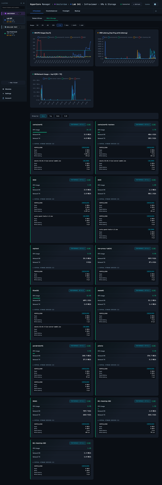

# Infraviewer

Infraviewer is the live view of the selected cluster: what the nodes are doing, how the drives
are, which VMs run where and how their storage performs. It has two panels, Nodes & Drives and
VMs & Storage, and a Cluster activity strip at the top.

## Cluster activity

The strip above the panels shows the tasks the cluster itself is running: exports, imports,
snapshots, migrations, with progress. It comes from HyperCore's task feed and needs the REST v2
switch (Settings → Clusters, API version; HyperCore 9.7.8 or later). Moves made by anything
other than this tool show up here too, which is how you notice another balancer or an
administrator working on the same cluster.

## Nodes & Drives

Pick a range (one hour up to a year) and read the four charts: CPU usage per node over time,
the cluster's total IOPS with its minimum, maximum and 95th percentile for the range, the
cluster's RAM usage, and storage capacity against what is used. Below them one card per node:
current CPU usage, memory used, the vCPU ratio as allocated vCPUs against physical cores (red
once it exceeds the balancer's `MAX_VCPU_RATIO`), how many samples the range holds, and the
node's physical drives with slot, health, used capacity and temperature. A drive turns amber
when HyperCore reports it degraded. A node whose data has not been refreshed within the stale
limit (Settings → Tunables, general) gets a warning marker; that usually means the collector
cannot reach the cluster or the node is down. A witness node or a node in maintenance is shown
as such and never receives VMs.

## VMs & Storage

Every VM of the cluster with its node, vCPUs, memory, CPU usage, network rates, and the
storage figures per VM: IOPS, throughput and the worst latency across its disks. Group the
list by tag, node, VLAN or peer with the selector above it. Click a VM for its detail panel:
CPU, network, and per-disk IOPS and latency over time, which is where a "the VM is slow"
question usually gets its answer.

The cluster totals above the list add up IOPS and throughput over all VMs; the latency shown
for the cluster is the worst disk, not an average, so one struggling disk is visible.

## What to look for

- A node consistently above the balancer's CPU or RAM threshold while others are idle: the
  Clusterbalancer chapter explains what the balancer does about it, and the migration log shows
  whether it did.
- A VM whose disk latency rises while its IOPS do not: contention on the storage side rather
  than a busy VM; Foresight's right-sizing uses the same signal.
- Drives with errors or a temperature out of line with their neighbours.
