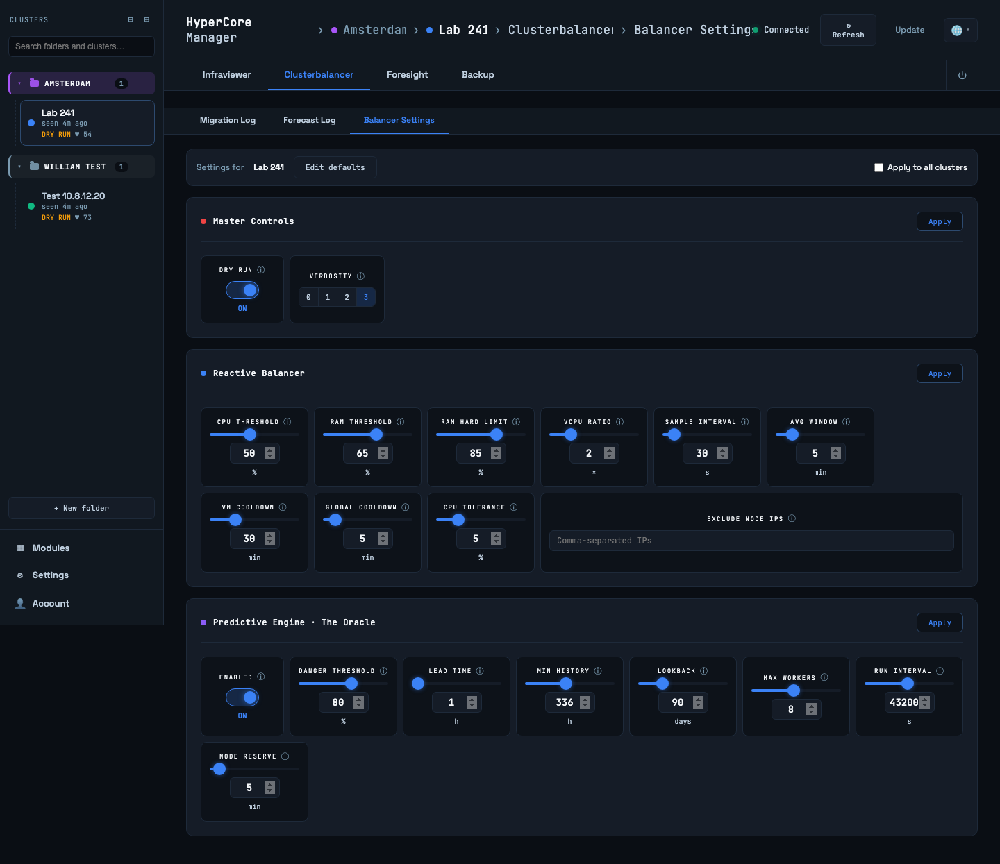
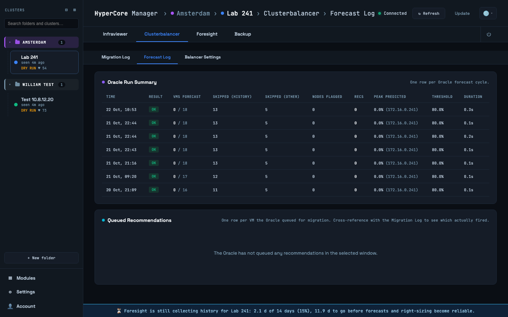

# Clusterbalancer

The Clusterbalancer keeps VMs spread over the nodes. It has three engines, in order of
priority: affinity rules from VM tags, the reactive balancer that reacts to sustained load, and
the Oracle, which forecasts load and moves VMs before a predicted spike. The tab shows what it
did and lets you tune it; the engines themselves run in the balancer container.

## Dry-run first

A newly registered cluster starts in **dry-run**: the balancer analyses, decides and logs every
move it would make, but moves nothing. Leave it there for a day or two and read the migration
log. When the decisions look right, switch `DRY_RUN` off under Balancer Settings. The rail shows
DRY RUN or LIVE under every cluster so there is never a doubt which mode you are in.

Only one installation may balance a given cluster live. If a second HyperCore Manager points at
the same cluster, keep its balancer in dry-run, otherwise the two move VMs against each other.

## Migration log

Every migration of the last seven days with time, VM, source and target node, the engine that
decided it (affinity, reactive, predictive) and the reason. In dry-run the mode column says so
and the move did not happen. With REST v2 in use the log also lists moves made outside this
tool, marked external: HyperCore's own rebalancing, an administrator, or another installation.

## Balancer settings

The same settings as Settings → Tunables, balancer group, shown next to the log for
convenience. The bar at the top says which cluster you are editing; Edit defaults changes what
a newly registered cluster starts with, and Apply to all clusters pushes a change everywhere.
The settings come in three groups, Master Controls, Reactive Balancer and the Oracle, each with
its own Apply button. The ones that matter most:

- **CPU and RAM upper thresholds**: above these a node becomes a source for migrations.
  `RAM_LIMIT_PERCENT` is the hard ceiling: a node at or above it never receives a VM.
- **Averaging window**: decisions use the rolling average over this many minutes, not the
  last sample, so a short spike does not trigger a move.
- **Cooldowns**: after a move the VM is left alone for `VM_MOVE_COOLDOWN_MINUTES`, and no
  further move starts cluster-wide for `MIGRATION_COOLDOWN_MINUTES`.
- **Excluded nodes**: addresses the balancer never moves to or from.
- **The Oracle**: `PREDICTIVE_BALANCING_ENABLED` switches the forecasting engine on; it needs
  `PREDICTIVE_MIN_HISTORY_HOURS` of history (14 days by default) before it acts, looks
  `PREDICTIVE_LEAD_TIME_HOURS` ahead, and reserves a node it is evacuating for
  `PREDICTIVE_RESERVATION_MINUTES`.

Each setting has an explanation, the reasoning behind its default and when to change it; open
it with the "i" next to the field. Changes apply at runtime, no restart.

## Forecast log

What the Oracle predicted and when: per run, the VMs whose forecast crossed the threshold
within the lead time and what it queued. Empty until the Oracle is enabled and has its history.

## Placement tags

Placement rules are tags on the VM in HyperCore, nothing is configured in the tool:

| Tag | Effect |
|---|---|
| `node_<suffix>` | pin the VM to the node whose address ends in `<suffix>`, for example `node_241` |
| `anti_<vm_name>` | never place this VM on the same node as `<vm_name>`, for example `anti_dc02` on `dc01` |

Affinity wins over everything: a pinned VM is moved back to its node even when that worsens the
balance. The balancer also never moves a VM that is rebooting or that the cluster is already
moving, exporting or snapshotting; with REST v2 it waits for a quiet moment.
