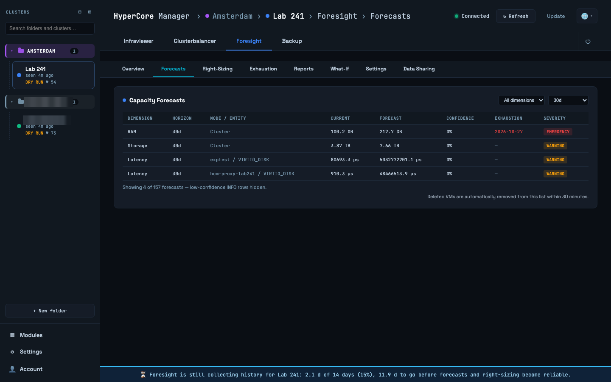
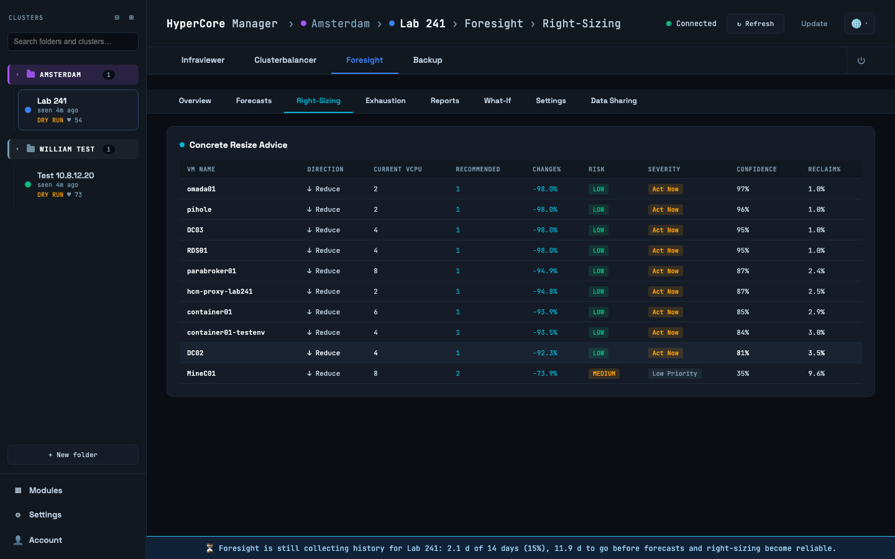
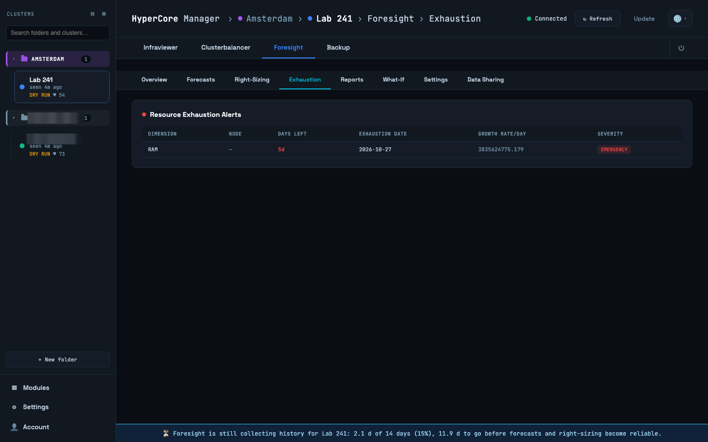
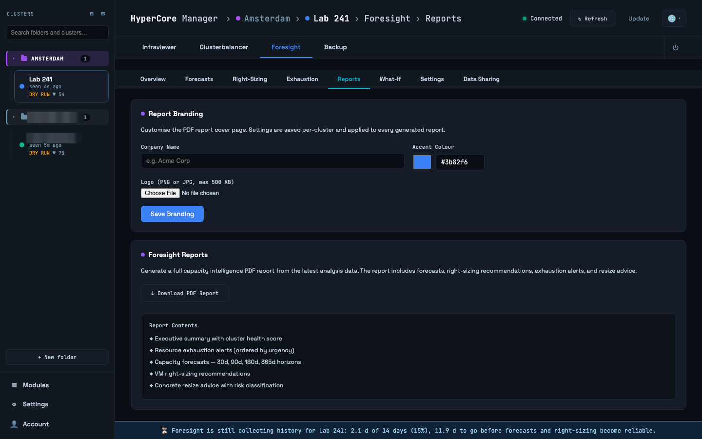
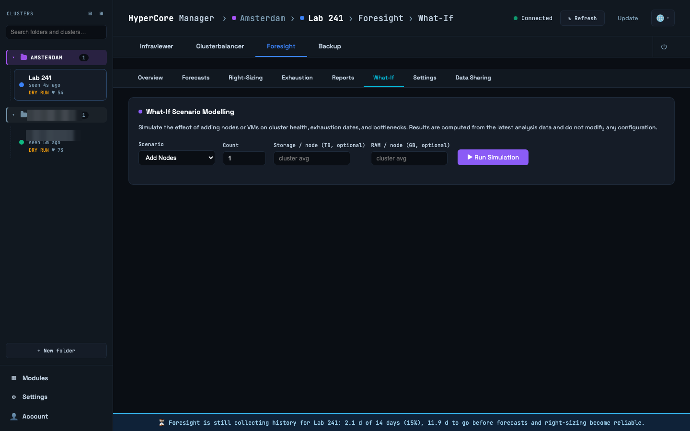
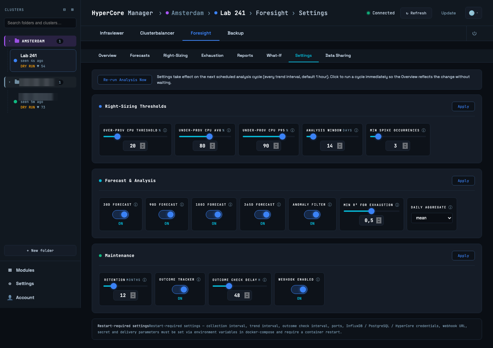

# Foresight

Foresight is the capacity intelligence of the selected cluster: where it is heading, which VMs
are over- or under-sized, how healthy it is, and what a change would do. It runs in the
sentinel container, analyses once an hour, and needs about 14 days of history before its
numbers are reliable; the footer bar counts those days down. Everything here is advice. Nothing
in this tab changes the cluster.

## Overview

The health score, 0 to 100, with its severity (INFO up to EMERGENCY), the bottleneck
resource, the efficiency index and the time of the last analysis. Below it the component
breakdown: a 0 to 100 score per dimension, CPU, RAM, storage capacity, storage latency and
network, each with the forecast severity behind it and its yearly trend; RAM also states the
N+1 headroom, whether the cluster survives one node loss or a rolling upgrade. The tiles count
the active forecasts, the over- and under-provisioned VMs and the nearest exhaustion, and the
exhaustion alerts that need attention are listed underneath.

## Forecasts

Capacity forecasts per dimension and node over four horizons: 30, 90, 180 and 365 days. Each
forecast carries a confidence; forecasts with low confidence are suppressed rather than shown as
if they meant something. Filter by dimension and horizon. "Exhaustion" is the date at which the
forecast crosses the limit for that dimension.

## Right-Sizing

VMs that are over- or under-provisioned, flagged by three independent signals: sustained CPU
usage, storage latency correlation, and recurring CPU spike patterns. Below the findings,
**Concrete Resize Advice** turns them into vCPU changes with a confidence and a risk class.
Foresight also records whether advice was followed: it polls HyperCore for vCPU changes and
keeps the outcome, so you can see later which recommendations held up.

## Exhaustion

The resource exhaustion alerts in one list, newest and most severe first: which dimension on
which node runs out when, at which confidence. CRITICAL and EMERGENCY alerts can be sent to a
webhook (signed, with retries); the endpoint is configured in `.env`.

## Reports

A PDF capacity report for the selected cluster: executive summary with the health score,
exhaustion alerts, forecasts, right-sizing and resize advice. Report Branding puts your company
name, accent colour and logo on the cover; it is per installation.

## What-If

Scenario modelling on the current forecasts: add nodes (with optional RAM and storage per
node), add a number of VMs, or add VMs "like" an existing one, and run the simulation. The
result compares the exhaustion dates of the baseline and the scenario per dimension and shows
what is gained or lost. Nothing is changed on the cluster.

## Settings

Foresight's own thresholds and toggles: the analysis cadence, confidence floors, the
right-sizing signals and their limits, retention of findings. They apply at runtime. The
defaults suit most clusters; change one when you know why, and read the explanation next to it.
