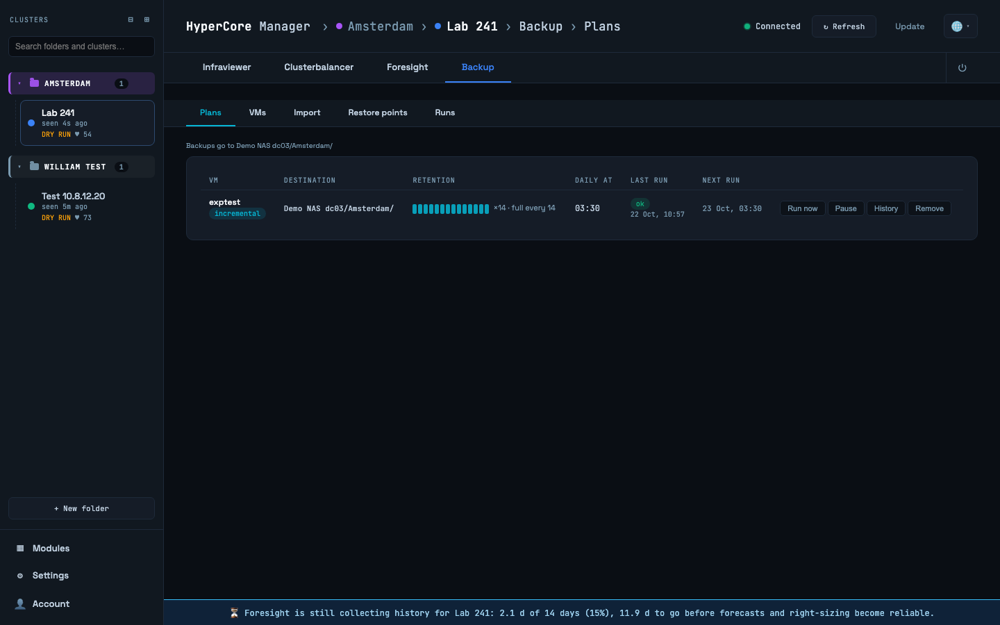
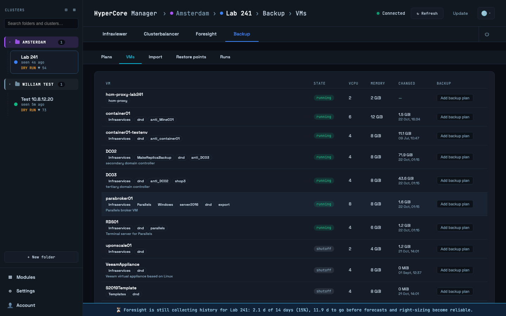
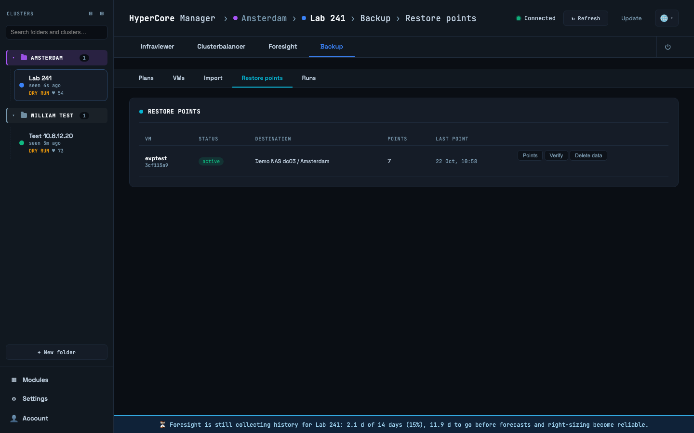
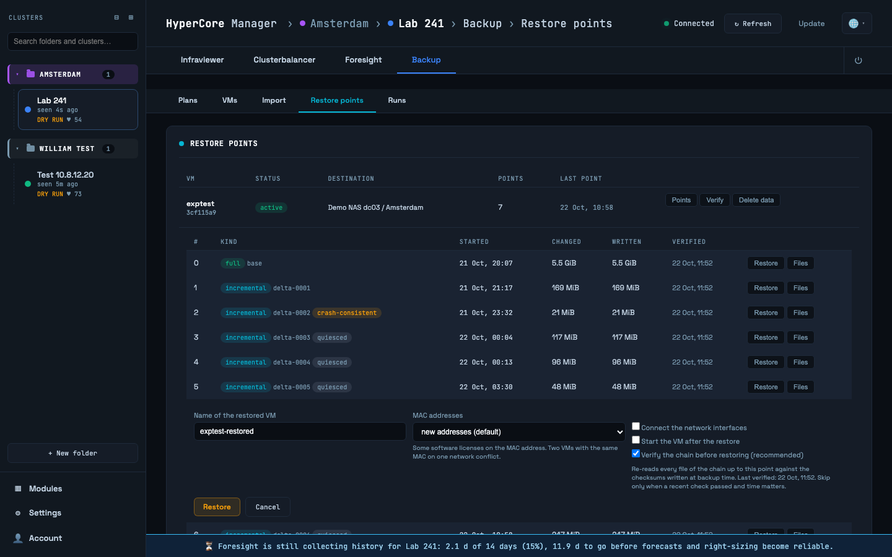
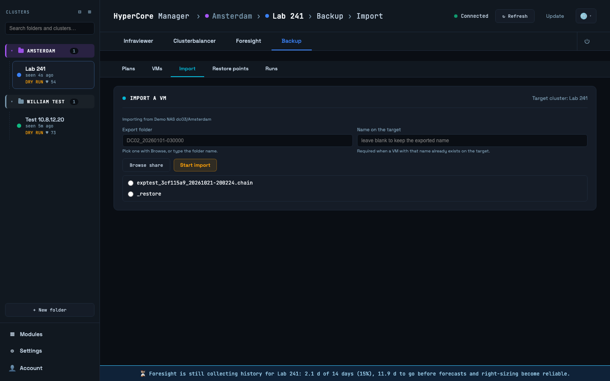
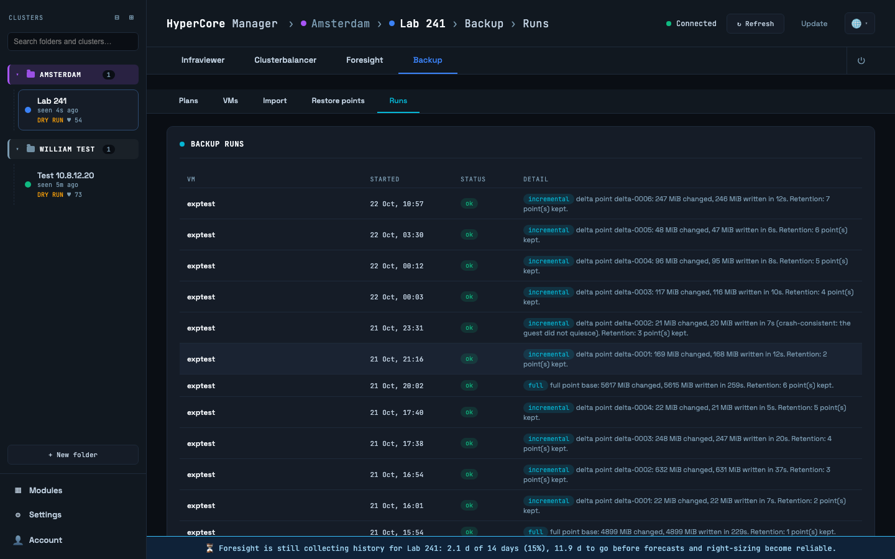

# Backup

The Backup tab protects the VMs of the selected cluster: plans say what to back up and when,
restore points are what a plan produced, and from a restore point you bring back a whole VM or
single files. Administrators define where backups go (targets) and the proxy that does the
work; users work with plans and restore points without seeing a path or a credential.

Two modes exist. **Incremental** backups go through a backup proxy on the cluster: HyperCore's
changed-block tracking tells the proxy which blocks changed since the last run, only those are
read and written as a chain of qcow2 images onto the target, a fresh full is taken every N runs,
and old points are merged away by retention. **Export** mode uses HyperCore's own export every
run, into a timestamped folder; it needs no proxy and suits small VMs. A cluster with a
registered proxy defaults to incremental.

## Plans

One row per plan: the VM, the destination (the target assigned to the cluster's folder and the
folder on it), retention, the daily time, the last and the next run. Times are in the cluster's
own time zone, read from HyperCore; where that differs from yours, the row shows your local
equivalent next to it ("03:00 US/Eastern · 09:00 your time"). Run now starts a run outside the
schedule, Pause stops the schedule without deleting anything, History opens the plan's runs.

## VMs

Every VM of the cluster with its plan, if any, and the **Changed** column: how many blocks
changed between the VM's two newest snapshots, which is what the next incremental would copy.
Schedule a VM from here: pick the mode, the daily time, retention in points and optionally in
days, and how many runs between fulls. The form says which time zone the time is in.

## Restore points

One chain per VM: the base and the deltas after it, each a point you can restore. A point shows
when it was taken, how much changed and was written, whether the guest was **quiesced** (the
guest flushed its state) or the point is **crash-consistent**, and when its files were last
verified. **Verify** re-reads every file of the chain against the checksums written at backup
time, in the background; a point whose files do not match is marked **corrupt**. The same check
runs weekly. **Delete data** removes a chain from the target and is the only action here that
deletes backups.

### Restoring a VM

Press **Restore** on a point. The form asks for the name of the new VM, whether to keep the
original MAC addresses (by default the copy gets new ones; HyperCore refuses to start a VM whose
MAC is in use by a running one), whether to connect its network interfaces, whether to start it,
and whether to verify the chain first. Leave the verification on: it re-hashes every file the
restore depends on before anything is created, and stops with the failing files named if they do
not match; the form shows when the point was last verified so you can judge whether to skip it
when time matters.

The restore creates a new VM; the original is never touched. The vTPM and firmware state travel
with the backup, so keys sealed in the TPM unseal on the copy. Disks come back on their original
bus and tiering. The entry under Runs follows the progress: verifying, importing the definition,
writing the disks, attaching them.

### Recovering single files

**Files** on a point mounts it read-only on the proxy and opens a browser of its filesystems
(ext4, XFS, btrfs, NTFS, LVM). Download a file or a selection as a zip, or deliver the
selection as an ISO straight into a running VM's CD-ROM, which needs no credentials for the
guest; eject it afterwards from the Runs panel. Nothing is written into a guest through the
hypervisor.

## Import

Import a VM from a HyperCore export directory on a share, for example to move a VM between
clusters or to bring back an export-mode backup. Known share locations are offered; the import
runs on the cluster and is followed under Runs.

## Runs

The history of runs, restores and imports for the cluster with their state and detail: what
kind of point a run produced, how much it copied, why a run was skipped or deferred. A run is
**deferred** when the cluster is updating itself or a node is missing; HyperCore cannot snapshot
then, and the next scheduled run tries again. A banner at the top of the tab says so while it
lasts.
