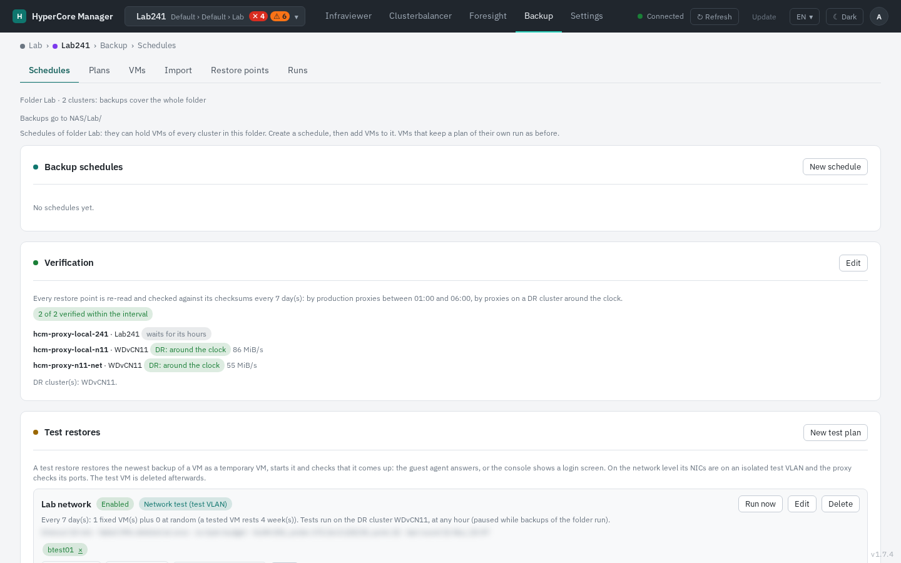
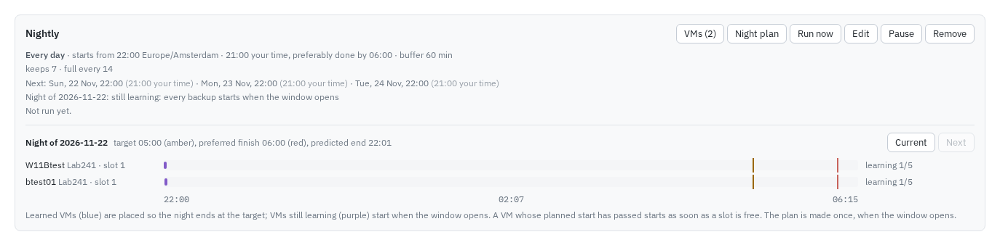
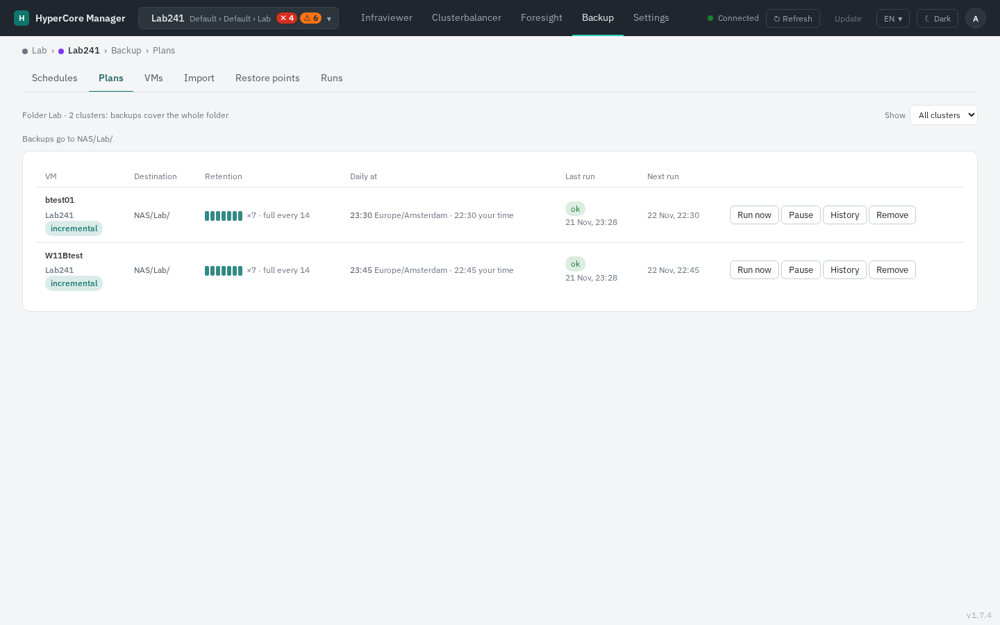
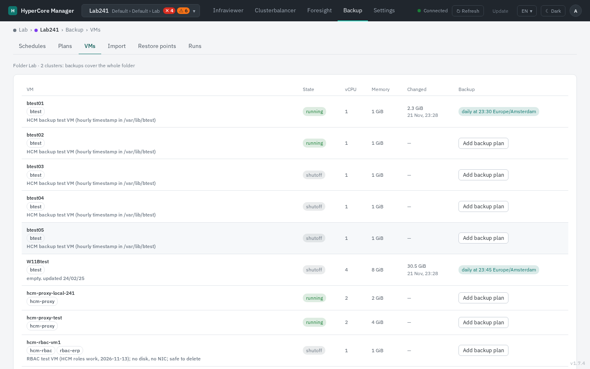
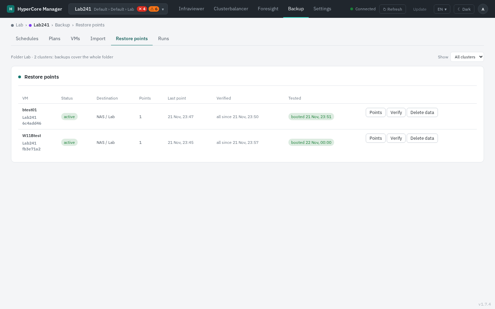
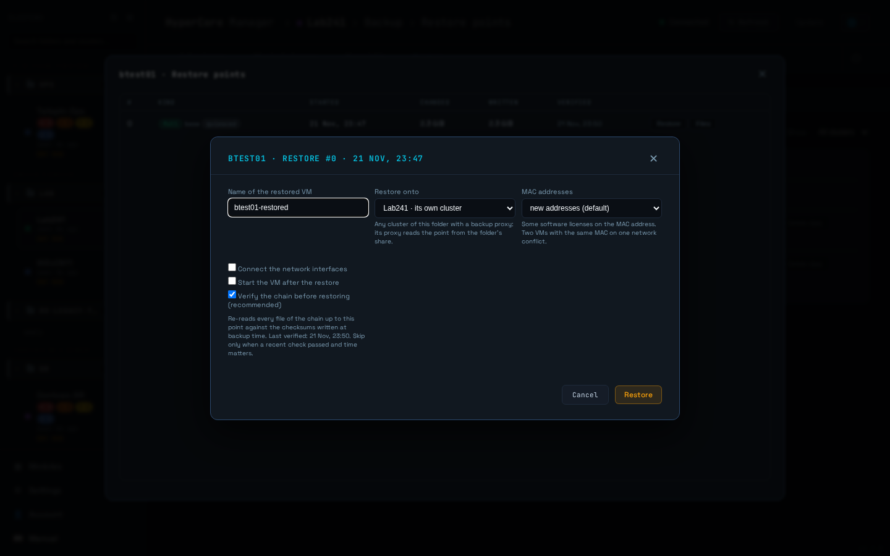
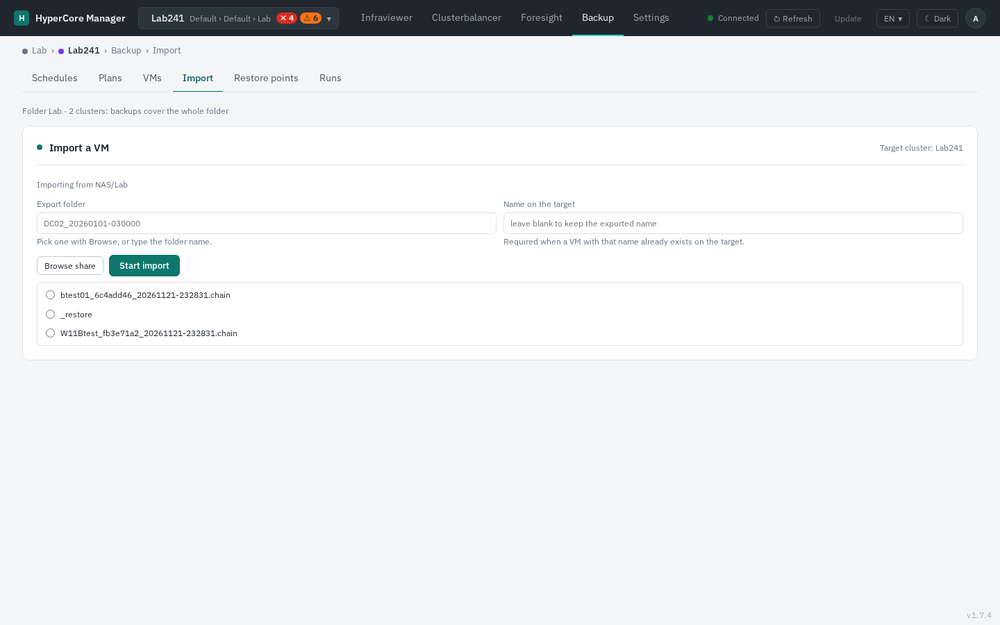
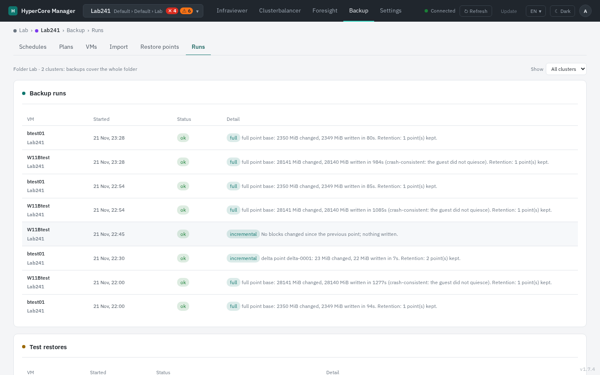

# Backup

The Backup tab protects the VMs of the selected cluster: plans say what to back up and when,
restore points are what a plan produced, and from a restore point you bring back a whole VM or
single files. Whoever manages the installation defines where backups go (targets) and the proxy
that does the work; everyone else works with schedules, plans and restore points without seeing a
path or a credential.

Two modes exist. **Incremental** backups go through a backup proxy on the cluster: HyperCore's
changed-block tracking tells the proxy which blocks changed since the last run, only those are
read and written as a chain of qcow2 images onto the target, a fresh full is taken every N runs,
and old points are merged away by retention. **Export** mode uses HyperCore's own export every
run, into a timestamped folder; it needs no proxy and suits small VMs. A cluster with a
registered proxy defaults to incremental.

## Schedules

A schedule backs up many VMs on one timetable: create the schedule first (**New schedule** opens the
schedule dialog; **Edit** on a schedule opens the same dialog), then add VMs to it with **VMs (n)**.
Schedules belong to the folder of the selected cluster and can hold VMs of every cluster in that
folder; select another cluster of the folder in the cluster switcher to add its VMs. **Backup schedules**
run incremental backups and **export schedules** run exports; a schedule never mixes the two.

- **Repeats** picks the days: every day or every N days, chosen weekdays every N weeks, the Nth or
  last weekday of the month, a day of the month, or any RFC 5545 rule (RRULE) for anything else,
  such as `FREQ=MONTHLY;BYDAY=-1SU` for the last Sunday of the month.
- **Every hour (or every N hours)** backs up more often than once a night, for smaller increments.
  The hours count from midnight: every 3 hours runs at 00:00, 03:00, 06:00 and so on. An hourly
  schedule has no earliest start, preferred finish or buffer: each run may start until the next one
  is due, and a run that is still busy then gets a *past preferred finish* notice. Blackouts still
  apply. With fulls on chosen days, the full is taken in the first run of that day.
- **Earliest start** is when backups of an occurrence may begin; **Preferred finish** is when the
  night should be done (earlier than the start means the next day). Runs that finish later get a
  notice.
- **No backups start** lists weekly periods in which nothing of this schedule starts, such as
  office hours. A run that is still busy when one begins is allowed to finish and gets a notice.
  A period ending at 23:59 lasts until midnight, so 00:00–23:59 covers a whole day: Saturday and
  Sunday 00:00–23:59 keeps an hourly schedule off for the weekend. On an hourly schedule, also
  consider **Keep for days**: *Copies to keep* counts restore points, and a weekend of hourly runs
  would otherwise push Friday's out.
- **Buffer** is the margin kept free before the preferred finish once durations are learned.
- **Time zone**: every time of the schedule is read in this zone, for every cluster in it. It
  defaults to the zone of the cluster the schedule was created on.

**Full backups** (backup schedules): every N runs, as for a plan of its own, or **on chosen days**,
such as the first Sunday of the month; on the other days every run is incremental. A full day only
counts when the schedule runs that day (the preview marks those windows *full*). Choose the kind:

- **Real** reads the whole VM again: the most independent copy, and the heaviest night for the
  cluster.
- **Synthetic** runs the normal incremental, checks the chain up to it, and then builds a new full
  from it on the target, without reading the VM again. The new full starts a new chain, so damage in
  the old chain can no longer reach later restore points; it costs one more full's worth of space
  on the target. If the chain fails its check, or the proxy cannot build the full, nothing is
  changed, the run gets a notice and the next run reads the VM in full. Restore points mark these
  fulls *synthetic*.

When a window opens, the members start one after the other: at most one backup per proxy of a
cluster at a time (one export per cluster). A VM is taken only once per occurrence. **Preview** in
the dialog lists the next windows before you save.

**Run now** backs up every VM of the schedule once, straight away, regardless of its window and its
blackouts, and also when the schedule is paused. It still runs one backup per proxy at a time, so a
large schedule takes a while; the card shows *manual run* until every VM has had its turn. A manual
run is always an incremental (or the full the chain needs), never the full of a full day, and it
gets no window notices. The schedule's own runs carry on as usual.

### Predicted finish

Each VM's backup time is learned from its own runs: how much usually changes on that weekday,
how fast the cluster's proxies read, and the fixed work around a copy (snapshot, clones,
cleanup). A full or synthetic full night adds the size of the VM's last full. A VM counts as
**learned** after five timed incrementals; until then it shows *learning n/5*.

When the window opens, the night is planned once:

- VMs still learning start right away, as before.
- Learned VMs are placed so the night ends at the **target**, the preferred finish minus the
  buffer: the backups run as late as possible, so they hold the freshest data and leave the early
  night quiet, and the buffer absorbs a slower night.
- A VM whose planned start has passed (the night runs behind) starts as soon as a proxy is free; a
  VM ahead of plan waits for its planned start.
- When the learned VMs do not fit between the opening and the target, they start right away and
  the card says by how much the night is predicted to run over.

**Night plan** on a schedule shows tonight (or the next night) per VM: the slot it runs in, the
planned start, the predicted end, and what actually ran. The amber line is the target, the red
line the preferred finish. Runs that end inside the buffer get the notice *into the buffer*; runs
that end after the preferred finish get *past preferred finish*. The members list shows each VM's
learned duration.

A VM belongs to one schedule at a time. Adding a VM that has a plan of its own takes that plan
into the schedule with its backups and chain kept (no new full); adding it to another schedule
moves it there. Removing a VM from a schedule, or deleting the schedule, leaves its plan paused
with its backups. VMs that keep a plan of their own run on their own time as before.

A **notice** (blue) is more than information and less than a warning: the run succeeded, but ran
into a blackout period, ended inside the buffer or past the preferred finish, or could not build
its synthetic full.

### Verification

Below the backup schedules, **Verification** says how the folder's restore points are checked (**Edit**
opens its settings in a dialog). A proxy
re-reads every file of a point and compares it with the checksums written when the point was made: that
proves the backup is still what was written, without restoring anything. Every restore point (also of
retired chains, which can still be restored) is checked once per interval, one point at a time:

- **Verify every point every** sets the interval in days (default 7; 0 switches it off). New points are
  checked first, usually within a day.
- **Hours for production proxies** (default 01:00–06:00, in each cluster's own time zone): a proxy on a
  production cluster verifies only then, only when its cluster has no backups running or due, and only a
  point that it can finish before the hours end and before the next backups start. A check that is still
  busy at the end of the hours stops and continues the next night. A verification takes the proxy, like a
  backup or a restore, so the two never share a proxy.
- A cluster marked **DR** (normally passive, see *Edit* on the cluster in the tenant tree) has proxies that
  verify **around the clock**: first what is due, then anything not checked for a day. While backups of the
  folder write to the share they pause between points, so the share's bandwidth goes to the backups;
  **DR proxies keep verifying while backups run** turns that pause off.

The section shows how many points were verified within the interval, how many are not verified yet, overdue
or failed, and per proxy whether it works now and its measured read speed.

A point that fails is checked a second time first (a hiccup on the share, or retention removing the point
while it is read, must not raise an alarm). A point that still fails is marked **corrupt**, shown as a red
(critical) badge on the cluster card, and mailed to the **closest administrator** of the folder: the folder's
own administrators, else the customer's, else the MSP's, else the installation's. A chain with a point not
verified for twice the interval gets an amber badge and a mail of its own. Mail needs Settings → Mail.

### Test restores

Verification proves the backup's bytes are what was written; a **test restore** proves the VM boots from them.
It restores the VM's newest point as a temporary VM (`<vm>-hcmtest-<n>`, tagged `hcm-testrestore`, new MAC
addresses), starts it, waits for a sign of life, keeps a screenshot of its console, and deletes it again.

A **test plan** (Backup → Schedules → **Test restores**; **New test plan** and **Edit** open a dialog, and
VMs are added to a plan on its card as **always test** or **never test**) belongs to the folder:

- **A round every** N days: the plan's fixed VMs (**always test**) plus **Random VMs per round** picked from the
  folder's backed-up VMs, longest untested first. A tested VM rests a number of weeks before it can be picked
  again; **never test** keeps a VM out of the random pick.
- **Where**: on the folder's **DR cluster** when it has one with a proxy, at any hour (paused while the folder's
  backups run). Without a DR cluster, on each VM's own cluster, only within **Hours on a production cluster**,
  outside backups, and only when the test is expected to finish before the next backups start. One test per
  target cluster at a time; a test needs a node with room for the VM's memory under the balancer's RAM ceiling,
  otherwise it is skipped with that reason.
- **Boot test (no network)**: the NICs stay disconnected. A pass is the **guest agent** answering (works without
  network) or, without an agent, the **console screen** showing a login, lock or sign-in screen. A stop screen,
  a BitLocker recovery screen (the vTPM did not unseal), "no bootable device", a crash, or nothing within
  **Sign of life within** minutes is a fail. A VM without a guest agent in production is marked *agentless:
  screen check only*, so a weaker pass is never mistaken for an agent pass.
- **Network test (test VLAN)**: the NICs go onto an isolated **test VLAN**, and after the boot check a proxy
  pings the VM and tries its ports (per VM, or the plan's default; without ports only ping counts, and Windows
  answers no ping by default). The checks run from a **proxy NIC on the test VLAN**, with the plan's **probe
  address** (a free address in the VMs' subnet, with prefix): HCM itself never touches the test VLAN. A test VLAN
  usually has no DHCP, so during the check the proxy hands the test VM, by DHCP, the address its source VM has
  (one static lease per test-VM MAC address, no pool: nothing else on the VLAN gets an address), and it keeps
  probing until the VM answers or the time is up. Restored
  VMs keep their addresses and names, so HCM refuses a VLAN that any other VM on the target cluster uses; whether
  the VLAN is routed elsewhere it cannot see, so keep it isolated on the switches too. The proxy needs to be
  deployed with 1.7.0 or later (it runs with host networking) and with a **Test VLAN** NIC (Settings → Targets →
  **+ Deploy a proxy VM**); the plan card warns when no proxy can run the checks.
- Options, off by default: **Keep a failed test VM for inspection** (hours), and a **Byte budget per round** (a
  test writes the whole VM: tests that would pass the budget are skipped in that round).

**Run now** queues a round at once (it still waits for a moment the target may take it). While a test runs, its
row under **Runs → Test restores** shows the step it is in: restoring (with the restore's own bar), booting (the
time waited against the timeout), the network checks, removing the test VM. Results appear under
**Runs → Test restores** (how it passed or failed, the target, the age of the point used, restore and boot time,
network checks, the screenshot) and as a **Tested** column on the restore points. A failed test is a red badge on
the cluster card and a mail to the closest administrator; a fixed VM without a passed test for twice the plan's
interval gets an amber badge and a mail. Test VMs are deleted after each test; a sweep every 15 minutes removes any
left behind (it only ever deletes VMs that carry both the tag and the name mark).

## Plans

One row per plan: the VM, the destination (the target assigned to the cluster's folder and the
folder on it), retention, the daily time, the last and the next run. Times are in the cluster's
own time zone, read from HyperCore; where that differs from yours, the row shows your local
equivalent next to it ("03:00 US/Eastern · 09:00 your time"). A VM in a schedule shows the
schedule's name instead of a time. Run now starts a run outside the schedule, Pause stops the
schedule without deleting anything, History opens the plan's runs.

## VMs

Every VM of the cluster with its plan, if any, and the **Changed** column: how many blocks
changed between the VM's two newest snapshots, which is what the next incremental would copy.
**Add backup plan** on a VM opens a dialog: pick the mode, the daily time, retention in points and
optionally in days, and how many runs between fulls. The dialog says which time zone the time is in.
For more than a few VMs a schedule is usually the better fit.

## Restore points

One chain per VM: the base and the deltas after it, each a point you can restore. **Points** opens
them in a window of fixed size, where **Restore** and **Files** work on each point. A point shows
when it was taken, how much changed and was written, whether the guest was **quiesced** (the
guest flushed its state) or the point is **crash-consistent**, and when its files were last
verified. **Verify** re-reads every file of the chain against the checksums written at backup
time, in the background; a point whose files do not match is marked **corrupt**. The **Verified**
column says per chain whether points failed, are overdue or still to check, or since when all of
them were verified; the planned verification (see *Verification* under Schedules) keeps it current.
**Delete data** removes a chain from the target and is the only action here that deletes backups.

### Restoring a VM

Press **Restore** on a point. A dialog opens over the restore points and asks for the name of the
new VM, the cluster to restore onto (**Restore onto**, when the folder has more clusters: the VM's own cluster by
default, or another cluster of the folder with a backup proxy, such as a DR cluster), whether to
keep the original MAC addresses (by default the copy gets new ones; HyperCore refuses to start a VM
whose MAC is in use by a running one), whether to connect its network interfaces, whether to start
it, and whether to verify the chain first. Leave the verification on: it re-hashes every file the
restore depends on before anything is created, and stops with the failing files named if they do
not match; the dialog shows when the point was last verified so you can judge whether to skip it
when time matters. Once the restore has started the dialog and the restore points window close and
the Runs panel opens.

The restore creates a new VM; the original is never touched. The vTPM and firmware state travel
with the backup, so keys sealed in the TPM unseal on the copy. Disks come back on their original
bus and tiering. The entry under Runs follows the progress with a bar: verifying the chain (purple),
preparing and importing the definition, writing the disks (green, in GiB), attaching them.

### Recovering single files

**Files** on a point mounts it read-only on the proxy and turns the window into a browser of its filesystems
(ext4, XFS, btrfs, NTFS, LVM). Download a file or a selection as a zip, or deliver the
selection as an ISO straight into a running VM's CD-ROM, which needs no credentials for the
guest; eject it afterwards from the Runs panel. Nothing is written into a guest through the
hypervisor. **← Restore points** goes back to the list and closing the window (✕, Escape or a
click beside it) does the same; both unmount the point.

A partition that cannot be mounted (an unknown filesystem, a damaged one, or a partition table the
proxy cannot read) is left out and the others stay browsable. When nothing in a point can be
mounted, the message names the reason for every partition; the proxy's **Download logs** (Settings)
has the details, including the kernel's own messages.

**Encrypted volumes** (BitLocker, LUKS) are found but stay locked until you give a key: the window
lists them and asks for one. For BitLocker that is the 48-digit recovery password, kept in Active
Directory, Entra ID or wherever it was saved when BitLocker was turned on; for LUKS the volume's
passphrase. Enter one key per line when volumes have different keys; each key is tried on every
volume. For BitLocker the window shows the volume's description (computer, drive, date) and the
**recovery key ID**: look the key up by that ID (in Active Directory Users and Computers or Entra ID
the first eight characters are enough), because a key that was rotated after the point was made
will not open it. The volume is opened read-only on the proxy for this browse only: the key is never stored or
logged, and the next time you open the point you enter it again. When a point holds both, the
unencrypted volumes are browsable at once and a line above the list offers to unlock the rest.

Points written before HyperCore Manager took a disk's full size show **end of disk missing**: for a
disk whose size is not a whole number of MiB, the last partial MiB (with the backup copy of the
partition table) is not in them. Restores and file browsing of those points work; the next backup
of the VM adds the missing end.

## Import

Import a VM from a HyperCore export directory on a share, for example to move a VM between
clusters or to bring back an export-mode backup. Known share locations are offered; the import
runs on the cluster and is followed under Runs.

## Runs

The history of runs, test restores, restores, imports and verifications for the cluster with their state and detail:
what kind of point a run produced, how much it copied, why a run was skipped or deferred, which proxy
verified a point, how much it read and how long it took.

Running work shows a progress bar instead of only *Running*. A backup is **green** while it copies (GiB done
of the total, and *device n of m*: disks, NVRAM and vTPM each count as a device), then **purple** while the proxy
checks the copied image and reads it back for its checksum, which takes minutes on a large disk. A sliding bar
means a step without a measurable size. The panel refreshes every 5 seconds while something runs and every
20 seconds otherwise, so work started by a schedule or someone else appears on its own. A run is
**deferred** when the cluster is updating itself or a node is missing; HyperCore cannot snapshot
then, and the next scheduled run tries again. A banner at the top of the tab says so while it
lasts.
