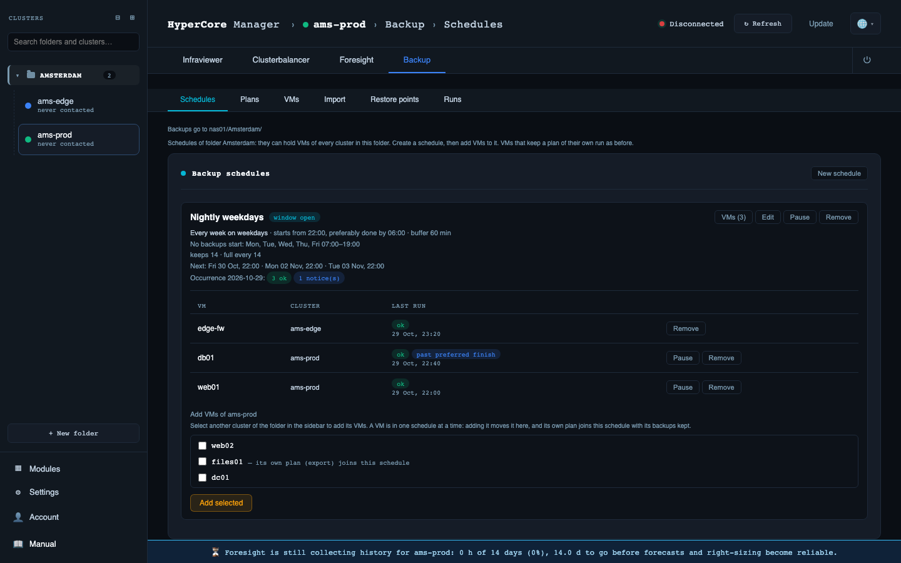
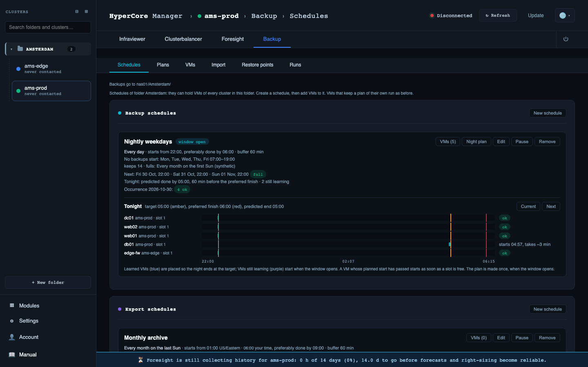
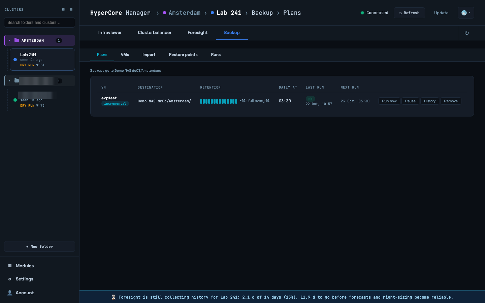
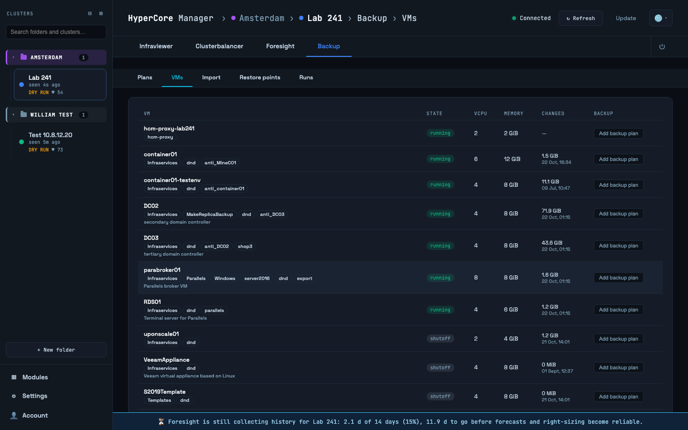
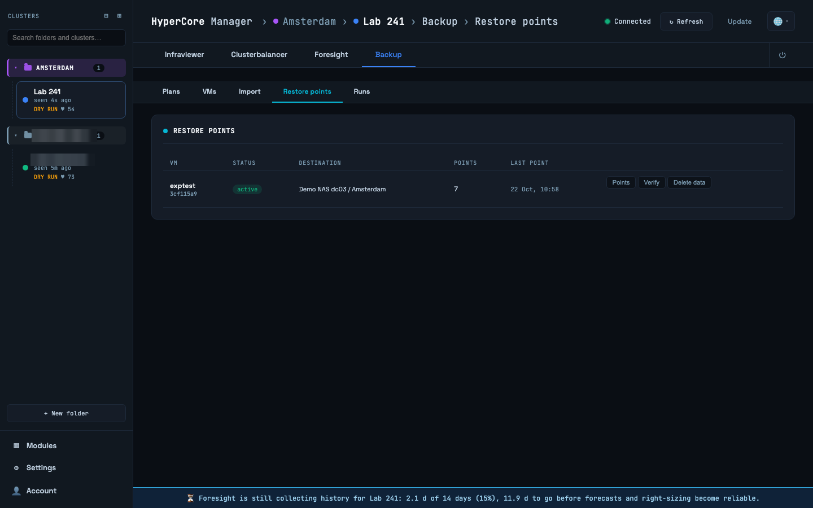
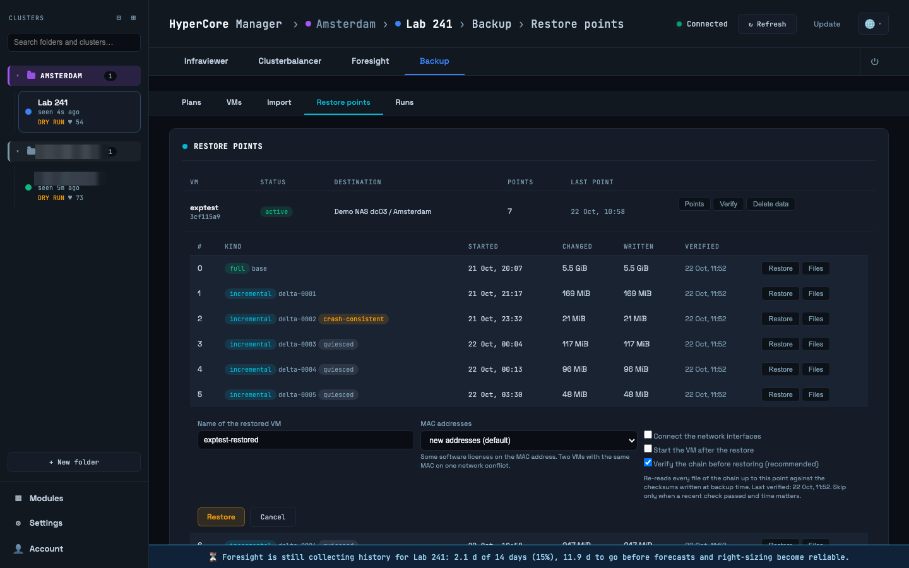
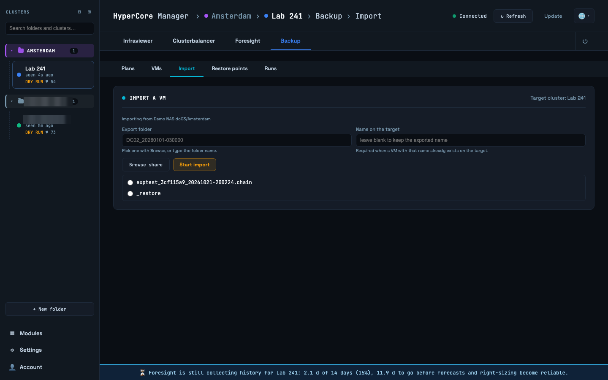
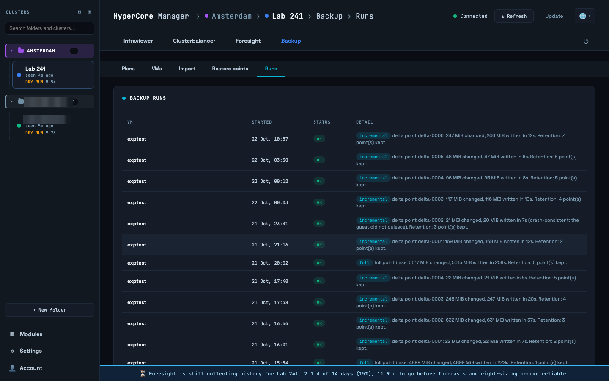

# Backup

The Backup tab protects the VMs of the selected cluster: plans say what to back up and when,
restore points are what a plan produced, and from a restore point you bring back a whole VM or
single files. Administrators define where backups go (targets) and the proxy that does the
work; users work with plans and restore points without seeing a path or a credential.

Two modes exist. **Incremental** backups go through a backup proxy on the cluster: HyperCore's
changed-block tracking tells the proxy which blocks changed since the last run, only those are
read and written as a chain of qcow2 images onto the target, a fresh full is taken every N runs,
and old points are merged away by retention. **Export** mode uses HyperCore's own export every
run, into a timestamped folder; it needs no proxy and suits small VMs. A cluster with a
registered proxy defaults to incremental.

## Schedules

A schedule backs up many VMs on one timetable: create the schedule first, then add VMs to it.
Schedules belong to the folder of the selected cluster and can hold VMs of every cluster in that
folder; select another cluster of the folder in the sidebar to add its VMs. **Backup schedules**
run incremental backups and **export schedules** run exports; a schedule never mixes the two.

- **Repeats** picks the days: every day or every N days, chosen weekdays every N weeks, the Nth or
  last weekday of the month, a day of the month, or any RFC 5545 rule (RRULE) for anything else,
  such as `FREQ=MONTHLY;BYDAY=-1SU` for the last Sunday of the month.
- **Earliest start** is when backups of an occurrence may begin; **Preferred finish** is when the
  night should be done (earlier than the start means the next day). Runs that finish later get a
  notice.
- **No backups start** lists weekly periods in which nothing of this schedule starts, such as
  office hours. A run that is still busy when one begins is allowed to finish and gets a notice.
- **Buffer** is the margin kept free before the preferred finish once durations are learned.
- **Time zone**: every time of the schedule is read in this zone, for every cluster in it. It
  defaults to the zone of the cluster the schedule was created on.

**Full backups** (backup schedules): every N runs, as for a plan of its own, or **on chosen days**,
such as the first Sunday of the month; on the other days every run is incremental. A full day only
counts when the schedule runs that day (the preview marks those windows *full*). Choose the kind:

- **Real** reads the whole VM again: the most independent copy, and the heaviest night for the
  cluster.
- **Synthetic** runs the normal incremental, checks the chain up to it, and then builds a new full
  from it on the target, without reading the VM again. The new full starts a new chain, so damage in
  the old chain can no longer reach later restore points; it costs one more full's worth of space
  on the target. If the chain fails its check, or the proxy cannot build the full, nothing is
  changed, the run gets a notice and the next run reads the VM in full. Restore points mark these
  fulls *synthetic*.

When a window opens, the members start one after the other: at most one backup per proxy of a
cluster at a time (one export per cluster). A VM is taken only once per occurrence. **Preview** in
the form lists the next windows.

### Predicted finish

Each VM's backup time is learned from its own runs: how much usually changes on that weekday,
how fast the cluster's proxies read, and the fixed work around a copy (snapshot, clones,
cleanup). A full or synthetic full night adds the size of the VM's last full. A VM counts as
**learned** after five timed incrementals; until then it shows *learning n/5*.

When the window opens, the night is planned once:

- VMs still learning start right away, as before.
- Learned VMs are placed so the night ends at the **target**, the preferred finish minus the
  buffer: the backups run as late as possible, so they hold the freshest data and leave the early
  night quiet, and the buffer absorbs a slower night.
- A VM whose planned start has passed (the night runs behind) starts as soon as a proxy is free; a
  VM ahead of plan waits for its planned start.
- When the learned VMs do not fit between the opening and the target, they start right away and
  the card says by how much the night is predicted to run over.

**Night plan** on a schedule shows tonight (or the next night) per VM: the slot it runs in, the
planned start, the predicted end, and what actually ran. The amber line is the target, the red
line the preferred finish. Runs that end inside the buffer get the notice *into the buffer*; runs
that end after the preferred finish get *past preferred finish*. The members list shows each VM's
learned duration.

A VM belongs to one schedule at a time. Adding a VM that has a plan of its own takes that plan
into the schedule with its backups and chain kept (no new full); adding it to another schedule
moves it there. Removing a VM from a schedule, or deleting the schedule, leaves its plan paused
with its backups. VMs that keep a plan of their own run on their own time as before.

A **notice** (blue) is more than information and less than a warning: the run succeeded, but ran
into a blackout period, ended inside the buffer or past the preferred finish, or could not build
its synthetic full.

## Plans

One row per plan: the VM, the destination (the target assigned to the cluster's folder and the
folder on it), retention, the daily time, the last and the next run. Times are in the cluster's
own time zone, read from HyperCore; where that differs from yours, the row shows your local
equivalent next to it ("03:00 US/Eastern · 09:00 your time"). A VM in a schedule shows the
schedule's name instead of a time. Run now starts a run outside the schedule, Pause stops the
schedule without deleting anything, History opens the plan's runs.

## VMs

Every VM of the cluster with its plan, if any, and the **Changed** column: how many blocks
changed between the VM's two newest snapshots, which is what the next incremental would copy.
Schedule a VM from here: pick the mode, the daily time, retention in points and optionally in
days, and how many runs between fulls. The form says which time zone the time is in.

## Restore points

One chain per VM: the base and the deltas after it, each a point you can restore. A point shows
when it was taken, how much changed and was written, whether the guest was **quiesced** (the
guest flushed its state) or the point is **crash-consistent**, and when its files were last
verified. **Verify** re-reads every file of the chain against the checksums written at backup
time, in the background; a point whose files do not match is marked **corrupt**. The same check
runs weekly. **Delete data** removes a chain from the target and is the only action here that
deletes backups.

### Restoring a VM

Press **Restore** on a point. The form asks for the name of the new VM, whether to keep the
original MAC addresses (by default the copy gets new ones; HyperCore refuses to start a VM whose
MAC is in use by a running one), whether to connect its network interfaces, whether to start it,
and whether to verify the chain first. Leave the verification on: it re-hashes every file the
restore depends on before anything is created, and stops with the failing files named if they do
not match; the form shows when the point was last verified so you can judge whether to skip it
when time matters.

The restore creates a new VM; the original is never touched. The vTPM and firmware state travel
with the backup, so keys sealed in the TPM unseal on the copy. Disks come back on their original
bus and tiering. The entry under Runs follows the progress: verifying, importing the definition,
writing the disks, attaching them.

### Recovering single files

**Files** on a point mounts it read-only on the proxy and opens a browser of its filesystems
(ext4, XFS, btrfs, NTFS, LVM). Download a file or a selection as a zip, or deliver the
selection as an ISO straight into a running VM's CD-ROM, which needs no credentials for the
guest; eject it afterwards from the Runs panel. Nothing is written into a guest through the
hypervisor.

## Import

Import a VM from a HyperCore export directory on a share, for example to move a VM between
clusters or to bring back an export-mode backup. Known share locations are offered; the import
runs on the cluster and is followed under Runs.

## Runs

The history of runs, restores and imports for the cluster with their state and detail: what
kind of point a run produced, how much it copied, why a run was skipped or deferred. A run is
**deferred** when the cluster is updating itself or a node is missing; HyperCore cannot snapshot
then, and the next scheduled run tries again. A banner at the top of the tab says so while it
lasts.
