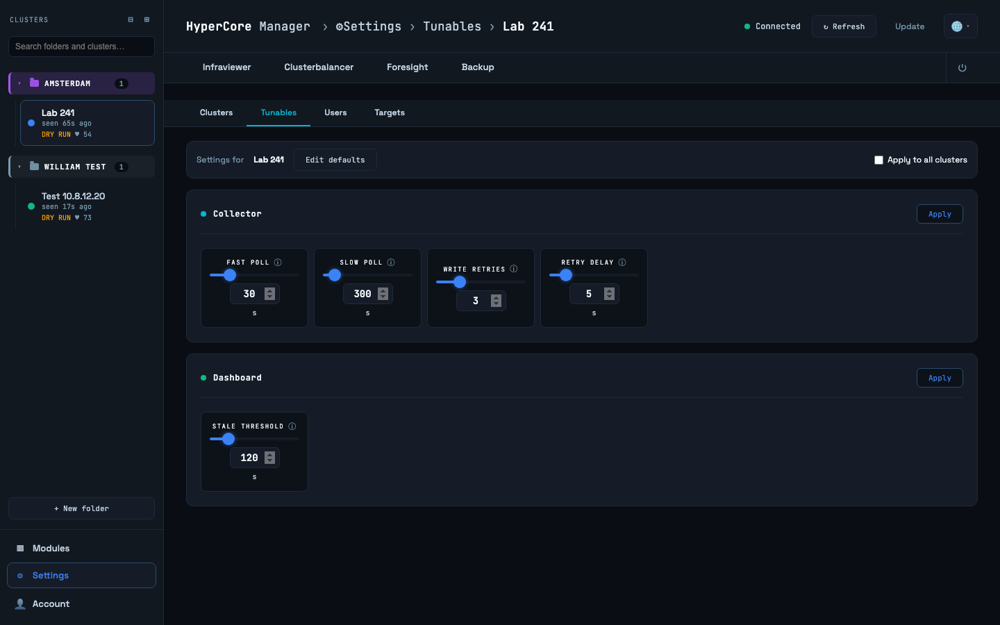
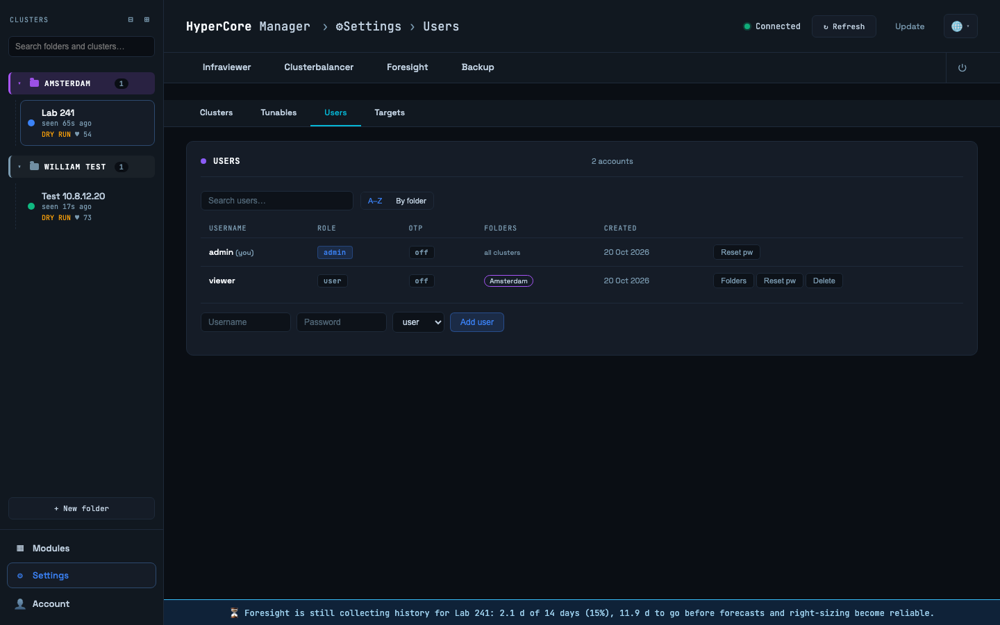
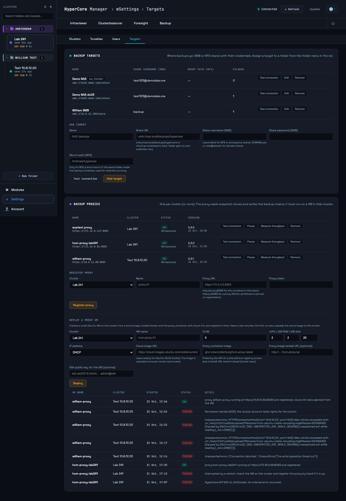

# Settings

Settings is for administrators. The four panels are described in full in the
[administration guide](../administration.md); this chapter is the map.

## Clusters

Every registered cluster with its nodes (green reachable, amber present but offline or out,
grey no longer listed), the HyperCore account in use, the API version in use and the HyperCore
version found, the cluster's time zone, and when it was last seen. **Test connection** logs in on
every known node and refreshes what the cluster reports, including nodes, version and time zone.
**Edit** changes the name, address, account, TLS verification, colour, API version, time zone
override and folder. **Disable** pauses collection and balancing while keeping the history;
**Remove** forgets the cluster. Registering the same cluster twice is detected and the duplicate's
balancer is suspended.

The time zone matters for backups: plan times are read in it. It is filled from the cluster;
type another IANA name only when the cluster's own setting is wrong.

## Tunables

The balancer's and the collector's settings, per cluster. The bar at the top chooses which
cluster you edit, or the Defaults that a newly registered cluster copies, or all clusters at
once. Each field has an explanation, the reasoning behind the default and when to change it.
Changes apply at runtime; the services re-read them within a minute.

## Users

Accounts and their role, administrator or user, and for users the folders they are members of.
A user without folders sees nothing. Two-factor authentication is per user and is set up by the
user under Account; an administrator can reset it here.

## Targets

Where backups go: SMB or NFS shares with their credentials, probed before they are saved. A
target is assigned to a folder; every cluster in the folder backs up to it, each under its own
tenant folder on the share. A target must live outside the cluster it protects: a share served
by a VM on the same cluster is a copy, not a backup.

Below the targets, **Backup proxies**: the proxies registered per cluster with their state and
version, **Test connection**, **Measure throughput**, which writes a few hundred megabytes onto
the cluster's target through each path a backup can use and reports the rates, and **Deploy a
proxy VM**, which creates the proxy VM for you from a cloud image.
