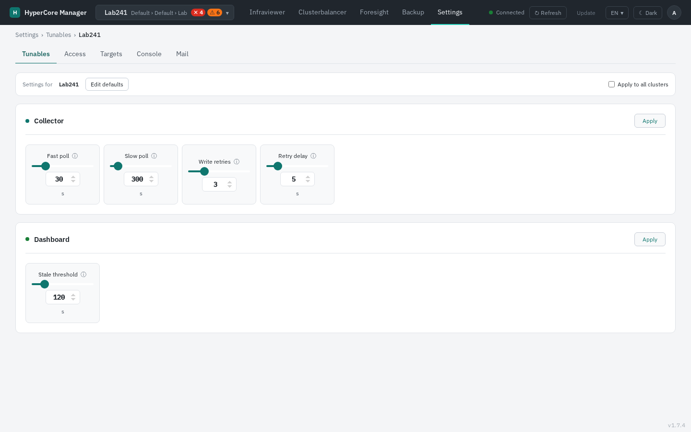
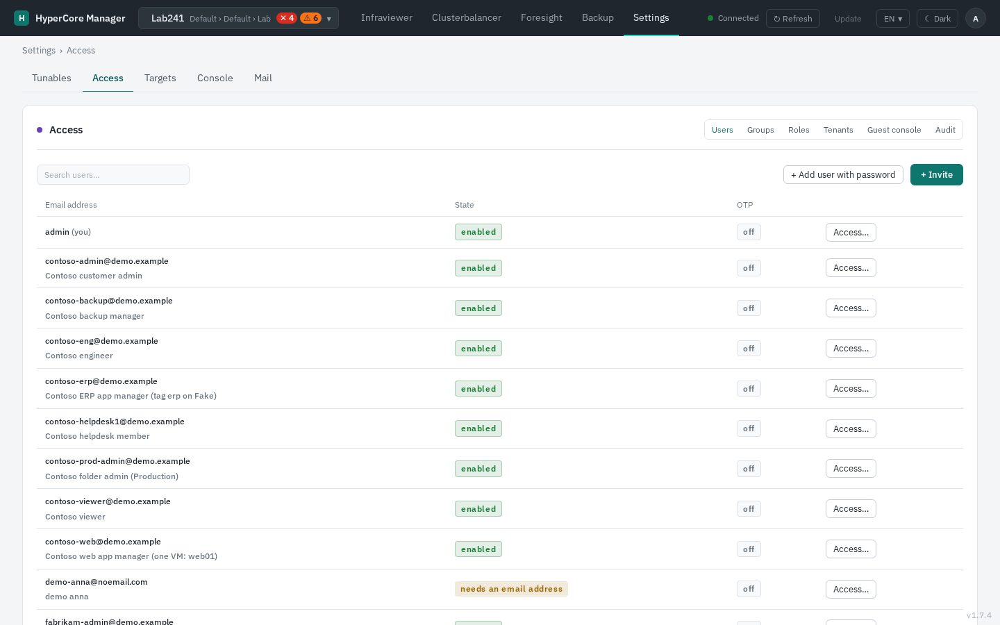
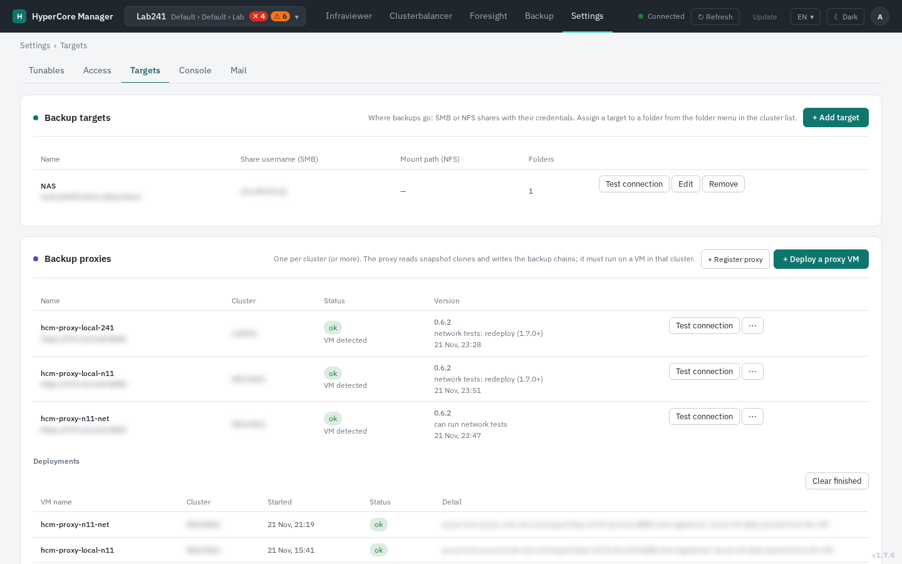

# Settings

Settings is for administrators. The four panels are described in full in the
[administration guide](../administration.md); this chapter is the map.

## Clusters

Clusters are registered and maintained in the tenant tree (**Access → Tenants**, below): **+ Cluster**
in a folder's cluster column for whoever may manage clusters there, and the selected cluster's pane
shows every registered cluster's nodes (green reachable, amber present but offline or out,
grey no longer listed), the HyperCore account in use, the API version in use and the HyperCore
version found, the cluster's time zone, and when it was last seen. **Test connection** logs in on
every known node and refreshes what the cluster reports, including nodes, version and time zone.
**Edit** changes the name, address, account, TLS verification, colour, API version, time zone
override and folder. **Disable** pauses collection and balancing while keeping the history;
**Remove** forgets the cluster. Registering the same cluster twice is detected and the duplicate's
balancer is suspended.

The time zone matters for backups: plan times are read in it. It is filled from the cluster;
type another IANA name only when the cluster's own setting is wrong.

## Tunables

The balancer's and the collector's settings, per cluster. The bar at the top chooses which
cluster you edit, or the Defaults that a newly registered cluster copies, or all clusters at
once. Each field has an explanation, the reasoning behind the default and when to change it.
Changes apply at runtime; the services re-read them within a minute.

## Access

Who may do what, and where. The tabs:

- **Users**: accounts (an account is an email address), **Invite** someone by address (a link
  that works once, for 48 hours; open invitations are listed with Resend and Withdraw), and
  **Access…** per account: its roles and where they apply (the whole installation, an MSP,
  customer or folder, a cluster, the VMs with a tag, or one VM), its groups, and **Remove from my
  tenants**. Disable, password reset, address and delete are for administrators of the whole
  installation.
- **Groups**: a group gives its access to every member.
- **Roles**: the five built-in roles (Admin, Engineer, App Manager, Backup Manager, Viewer) are
  templates; **Copy** one to make your own with exactly the permissions you want.
- **Tenants**: MSPs, customers, folders and clusters in columns, like a file browser. Click
  through them; the pane on the right shows who is assigned on what you selected, and what it
  inherits from above. Assign or remove people there.
- **Guest console**: one-time console access for someone outside: a link plus a code, one VM, a
  time window. Requests from colleagues who may only ask wait here for approval; the approvers
  nearest the VM also get a mail with a link straight to the request. A console has one outside
  person at a time: giving access to a new one revokes the previous one, after a warning.
- **Audit**: every change to access, and every guest console event.

You only see, and only hand out, what lies within your own reach: nobody gives away rights they do
not hold, and nobody changes their own access. Two-factor authentication is set up by each user
under Account. The details are in the administration guide.

## Console

Administrators only. **Open console sessions** checks, for the selected cluster, whether a VM's
console was left logged in: someone logged in on the console and walked away. When it is on,
HCM takes a screenshot of each running VM's console every 30 minutes (configurable), spread
over that interval, and looks for a lock or login screen. A console that shows neither becomes
an orange warning on the cluster's card, "console session open since …", until it is locked
again.

- **Text consoles** (Linux) are read with text recognition: a login prompt counts as locked as
  long as no shell prompt follows it. No setup needed.
- **Graphical lock screens** without readable text (a Windows 10/11 lock screen with only a
  clock) need **Learn locked**: put the VM in its locked state and click it; HCM remembers that
  screen. Learn more than once for lock screens that change (rotating backgrounds). A false
  alarm on the cluster card has the same button, so it is fixed in one click.
- **Wake the screen.** A blanked screen looks the same whether the session behind it is locked
  or not, so without waking a black screen is *blank (unknown)*, never a pass. A pointer nudge is
  the least intrusive way to wake it; Shift is the alternative.
- **Keep the last screenshot** is off by default: a screenshot of an open session can show
  passwords or customer data. Off, only the verdict is stored.
- **Exclude** VMs that are meant to stay logged in, such as kiosks or appliances. A muted
  warning on the cluster card hides it for some days instead.

The check only sees the console: an RDP session left open is invisible to it. Every screenshot
is in the **console log** below as user `system`, hidden unless *Show automated screenshots*
is ticked; those rows are kept for 30 days, the others for good.

## Mail

One mail server for the whole installation, set by its administrators: invitations, password
resets and address changes go out through it. Enter the SMTP server, port and security (STARTTLS on
587, TLS on 465, or none on 25 for a relay on your own network), an optional login, the sender
address and name, and the **address in links**: how people reach this dashboard (empty: the address
you are using). **Send test mail** checks it. Without a mail server, whoever sends an invitation
gets the link to pass on themselves.

## Targets

Where backups go: SMB or NFS shares with their credentials, probed before they are saved. A
target is assigned to a folder; every cluster in the folder backs up to it, each under its own
tenant folder on the share. A target must live outside the cluster it protects: a share served
by a VM on the same cluster is a copy, not a backup.

Below the targets, **Backup proxies**: the proxies registered per cluster with their state and
version, **Test connection**, **Measure throughput**, which writes a few hundred megabytes onto
the cluster's target through each path a backup can use and reports the rates, and **Deploy a
proxy VM**, which creates the proxy VM for you from a cloud image and pushes this installation's
proxy image onto it. The version column compares each proxy with the installation; a proxy that
lags shows **Update**, which pushes the current image and restarts the proxy on it (the backup
service does this on its own after a stack update, for every idle proxy). The deployment log under
the form keeps its finished rows for 30 days, except the last successful row of each registered
proxy; **Clear finished** empties it right away. **Remove** takes the
registration away and, for a proxy with a VM behind it, asks whether that VM goes too: the
VM is then powered off and deleted from the cluster. Only a VM the dashboard deployed is
deleted (it carries the `hcm-proxy` tag); a proxy container you put on a VM of your own is
left for you to clean up.

**Download logs** fetches a zip from a proxy for troubleshooting, without a login on its VM: the
proxy's own log, its recent jobs and open file-level mounts, and the state of the system it runs
on (kernel messages, block, loop and device-mapper devices, mounts, disk space, memory, processes).
Passwords and tokens are left out. Proxies older than 0.5.1 cannot make one yet; update them
first.
