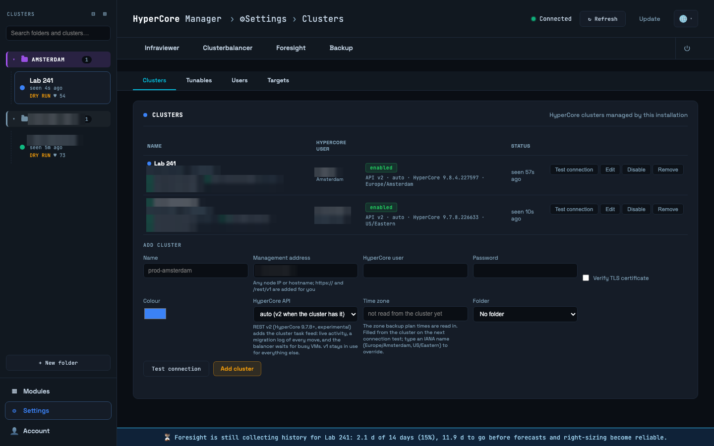
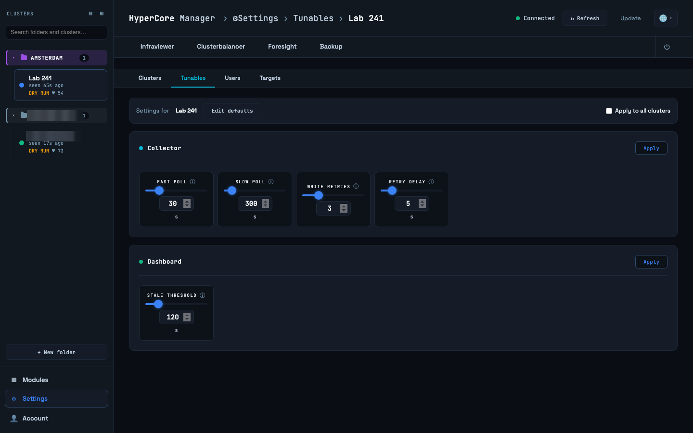
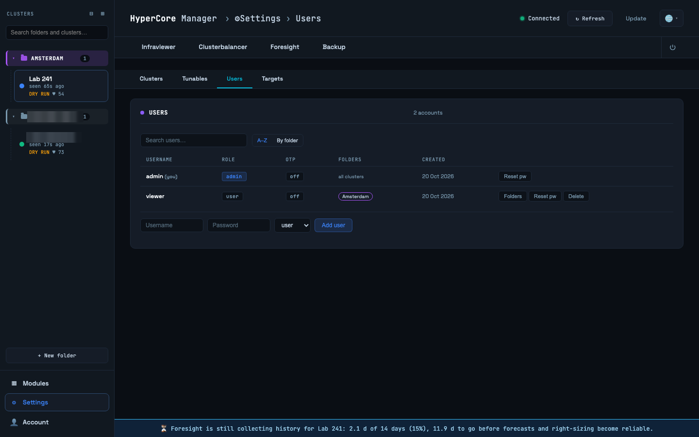
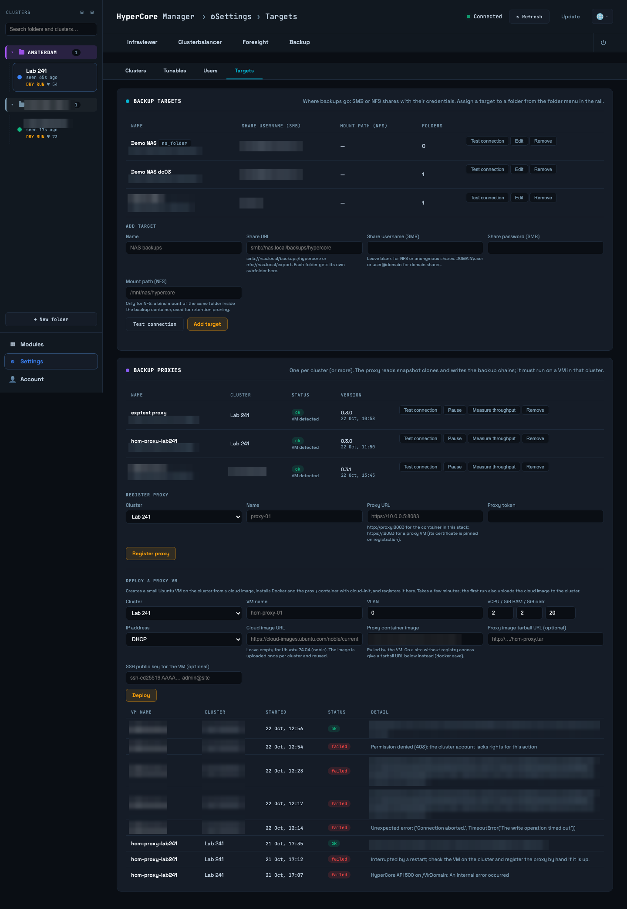

# Settings

Settings is for administrators. The four panels are described in full in the
[administration guide](../administration.md); this chapter is the map.

## Clusters

Every registered cluster with its nodes (green reachable, amber present but offline or out,
grey no longer listed), the HyperCore account in use, the API version in use and the HyperCore
version found, the cluster's time zone, and when it was last seen. **Test connection** logs in on
every known node and refreshes what the cluster reports, including nodes, version and time zone.
**Edit** changes the name, address, account, TLS verification, colour, API version, time zone
override and folder. **Disable** pauses collection and balancing while keeping the history;
**Remove** forgets the cluster. Registering the same cluster twice is detected and the duplicate's
balancer is suspended.

The time zone matters for backups: plan times are read in it. It is filled from the cluster;
type another IANA name only when the cluster's own setting is wrong.

## Tunables

The balancer's and the collector's settings, per cluster. The bar at the top chooses which
cluster you edit, or the Defaults that a newly registered cluster copies, or all clusters at
once. Each field has an explanation, the reasoning behind the default and when to change it.
Changes apply at runtime; the services re-read them within a minute.

## Users

Accounts and their role, administrator or user, and for users the folders they are members of.
A user without folders sees nothing. Two-factor authentication is per user and is set up by the
user under Account; an administrator can reset it here.

## Console

Administrators only. **Open console sessions** checks, for the selected cluster, whether a VM's
console was left logged in: someone logged in on the console and walked away. When it is on,
HCM takes a screenshot of each running VM's console every 30 minutes (configurable), spread
over that interval, and looks for a lock or login screen. A console that shows neither becomes
an orange warning on the cluster's card, "console session open since …", until it is locked
again.

- **Text consoles** (Linux) are read with text recognition: a login prompt counts as locked as
  long as no shell prompt follows it. No setup needed.
- **Graphical lock screens** without readable text (a Windows 10/11 lock screen with only a
  clock) need **Learn locked**: put the VM in its locked state and click it; HCM remembers that
  screen. Learn more than once for lock screens that change (rotating backgrounds). A false
  alarm on the cluster card has the same button, so it is fixed in one click.
- **Wake the screen.** A blanked screen looks the same whether the session behind it is locked
  or not, so without waking a black screen is *blank (unknown)*, never a pass. A pointer nudge is
  the least intrusive way to wake it; Shift is the alternative.
- **Keep the last screenshot** is off by default: a screenshot of an open session can show
  passwords or customer data. Off, only the verdict is stored.
- **Exclude** VMs that are meant to stay logged in, such as kiosks or appliances. A muted
  warning on the cluster card hides it for some days instead.

The check only sees the console: an RDP session left open is invisible to it. Every screenshot
is in the **console log** below as user `system`, hidden unless *Show automated screenshots*
is ticked; those rows are kept for 30 days, the others for good.

## Targets

Where backups go: SMB or NFS shares with their credentials, probed before they are saved. A
target is assigned to a folder; every cluster in the folder backs up to it, each under its own
tenant folder on the share. A target must live outside the cluster it protects: a share served
by a VM on the same cluster is a copy, not a backup.

Below the targets, **Backup proxies**: the proxies registered per cluster with their state and
version, **Test connection**, **Measure throughput**, which writes a few hundred megabytes onto
the cluster's target through each path a backup can use and reports the rates, and **Deploy a
proxy VM**, which creates the proxy VM for you from a cloud image and pushes this installation's
proxy image onto it. The version column compares each proxy with the installation; a proxy that
lags shows **Update**, which pushes the current image and restarts the proxy on it (the backup
service does this on its own after a stack update, for every idle proxy). The deployment log under
the form keeps its finished rows for 30 days, except the last successful row of each registered
proxy; **Clear finished** empties it right away. **Remove** takes the
registration away and, for a proxy with a VM behind it, asks whether that VM goes too: the
VM is then powered off and deleted from the cluster. Only a VM the dashboard deployed is
deleted (it carries the `hcm-proxy` tag); a proxy container you put on a VM of your own is
left for you to clean up.

**Download logs** fetches a zip from a proxy for troubleshooting, without a login on its VM: the
proxy's own log, its recent jobs and open file-level mounts, and the state of the system it runs
on (kernel messages, block, loop and device-mapper devices, mounts, disk space, memory, processes).
Passwords and tokens are left out. Proxies older than 0.5.1 cannot make one yet; update them
first.
