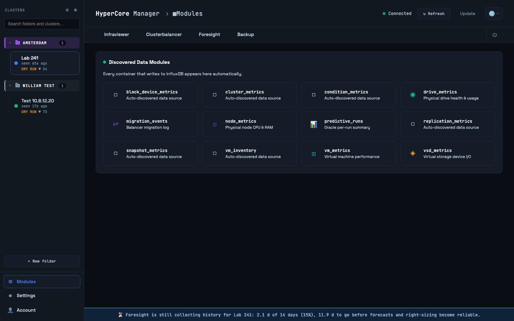
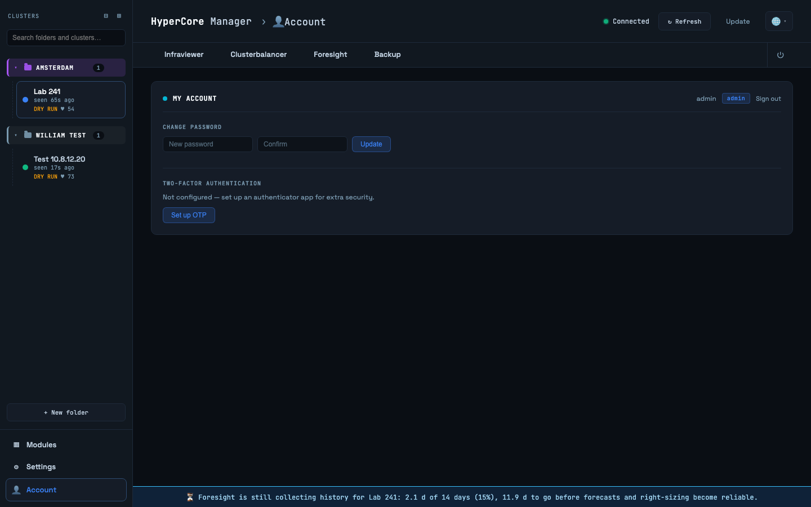

# Modules and Account

## Modules

Administrators only. Every container that writes to InfluxDB appears here as a data module
with its measurements, whether it is connected and when it last wrote. It is the quickest way to
see that the collector, the balancer and Foresight are alive and producing data for the selected
cluster, and to explore the raw measurements without a query tool.

## Account

Your own account: change your password, and set up or remove two-factor authentication with a
time-based one-time password app. Two-factor applies to your account only; an administrator can
reset it for you if you lose the device. This page is the same for administrators and users.
